[^Date]: 2026.11.09
[^Title]: 旋律
[^Tag]: Music, Composition
[^Order]: 3

> Supremacy to melody!  ——Olivier Messian

## 教会调式

`C D E F G A B C`是C自然大调调式。如果对C自然大调在钢琴白键上作平移，就会得到六个其他主音上的不同调式。所有这七个调式统称为“教会调式(Church Mode)”，或“中古调式(Medieval Mode)”。其中，以第六级A出发的调式`A B C D E F G A`就是我们熟悉的自然小调调式。下面我们讨论其余五个教会调式。

### 多利亚调式

`D E F G A B C D`称为主音为D的多利亚调式(Dorian Mode)。对比D上的自然小调音阶`D E F G A Bb C D`，多利亚调式可以看作是在自然小调音阶上升高了第六级音。这个被升高的第六级音是多利亚调式最显著的特征，它在一个小调音阶上带来明亮的色彩，形成强烈的对比。

「Scarborough Fair」使用D调的多利亚调式，B$\natural$体现多利亚色彩：

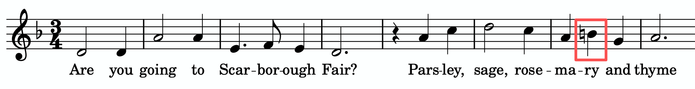

「橄榄树」也是D调的多利亚调式：

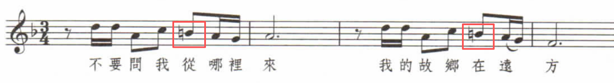

「原神」主题曲使用E调的多利亚调式，`C#`是它的色彩：

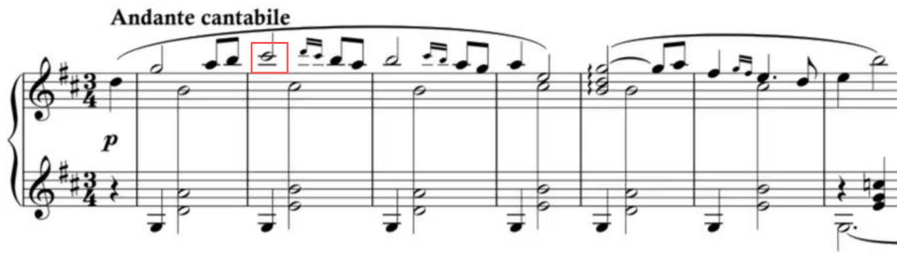

> 就好像D调的多利亚调式可以用C大调记谱，E调的多利亚调式可以用D大调记谱。

### 弗里吉亚调式

`E F G A B C D E`称为主音为E的弗里吉亚调式(Phrygian Mode)。弗里吉亚调式常用在西班牙或阿拉伯风格的音乐中。弗里吉亚调式最突出的特点就是第一级音和第二级音之间的半音关系，渲染出一种神秘、遥远的听感。

在弗里吉亚调式的基础上升高第三级音，得到E F $\sharp$G A B C D E，这一变体称为弗里吉亚属调式(Phrigian Dominant)。弗里吉亚属调式比一般的弗里吉亚调式更为常用，能表现更浓郁的西班牙、阿拉伯风情。

应用了弗里吉亚调式的作品：比才《卡门》

### 利底亚调式

`F G A B C D E F`是主音为F的利底亚调式(Lydian Mode)。和F自然大调音阶`F G A Bb C D E F`相比，升高了第四级音。C调的利底亚调式为`C D E F# G A B C`。

利底亚调式的前四个音之间音程相等（都为`+2`），形成类似全音阶的听感。第四个音和主音之间形成增四度的不协和听感。

「原神」“诗人的工作”使用A调的利底亚调式，`D#`是它的色彩：

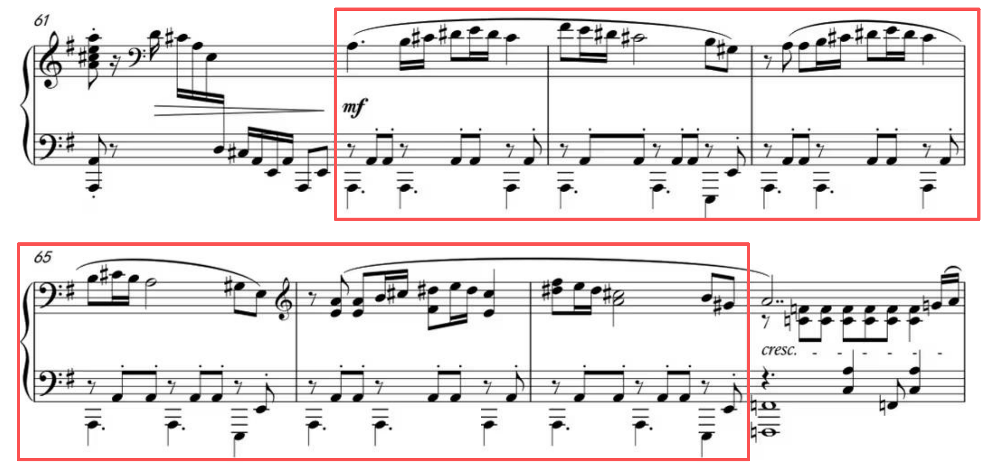

在利底亚调式的基础上降低七音，形成的调式称为利底亚属调式(Lydian Dominant Mode)。“属”得名于对第七音的降低。降低七音以后，这个调式里有五个音和全音阶重合。C调的利底亚属调式为`C D E F# G A Bb C`。

> 利底亚属调式又称为“利底亚-混合利地亚调式(Lidian-Mixolydian Mode)”，因为混合利地亚就是自然大调音阶降七音。

德彪西的「欢乐岛」的第9小节开始的主题使用A调利底亚属调式（使用G$\natural$），然后在第10小节使用原本的利底亚调式（$G\sharp$），第11小节恢复为利底亚属调式。

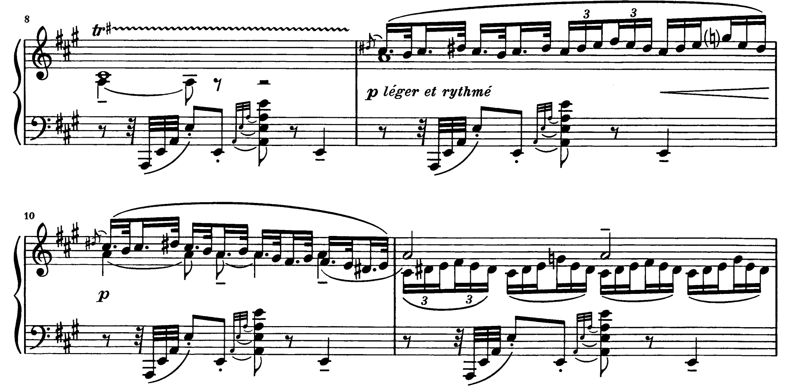

「欢乐岛」随后过渡到一个全音阶的主题，利用了利底亚调式、利底亚属调式与全音阶在pc set上的相似性：

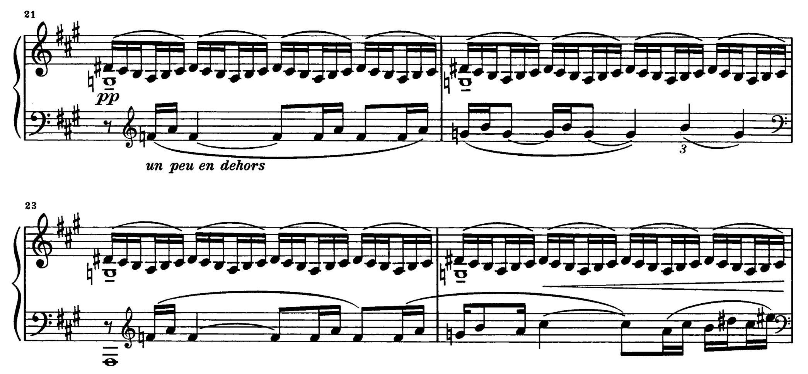

### 混合利底亚调式

G A B C D E F G称为主音为G的混合利底亚调式(Mixolydian Mode)。和G自然大调音阶对比：G A B C D E $\sharp$F G，混合利底亚调式在第七级音上降了一个半音。在自然大调中，第七级音（导音）有强烈的向主音解决的倾向。在混合利底亚调式中，因为第七级音被降了半音，这一解决倾向被弱化，营造出一种钝感。

在混合利底亚调式上的基础上给第三级音降低一个半音，就会立即得到多利亚调式。所以，多利亚调式可以看作混合利底亚调式的“小调”版本（只看主音上的三和弦顺阶和弦的话）。正是因为如此，混合利底亚调式常和多利亚调式穿插使用，就好像自然大调和自然小调的穿插使用一样。

属和弦向上堆叠恰好会构成混合利底亚音阶（自然大调降第7级音），因此混合利底亚通常可以作为属和弦的旋律声部。它的听感稳重、自然，有民谣或早期摇滚乐的感觉。

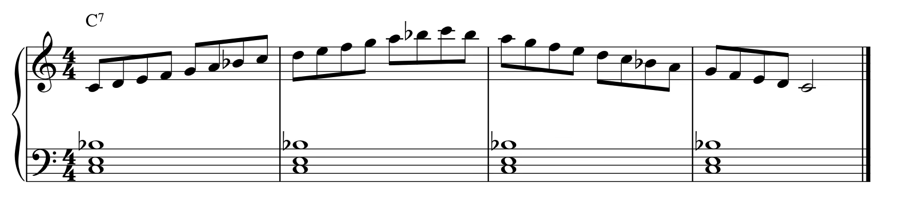

### 洛克里亚调式

B C D E F G A B称为主音为B的洛克里亚调式(Locrian Mode)。这是一个较为小众的调式。

和弗里吉亚调式一样，它的第一级音与第二级音之间也是小二度。然而在洛克里亚调式中，主音上的三和弦是极其紧张的减三和弦：B D F。这是中古调式中唯一一个主音上的三和弦不是大三或小三和弦的调式。

## 五声调式

`C B E G A`是C调的五声调式。在中国古代这五个音分别称为“宫”、“商”、“角(jué)”、“徵(zhǐ)”、“羽”。它去掉了大调自然音阶包含增四度的四音和七音，同时消除了它们与主音、三音之间形成小二度的可能性，因此听感和谐、大气、典雅。

「彩云追月」：（A调的五声调式）

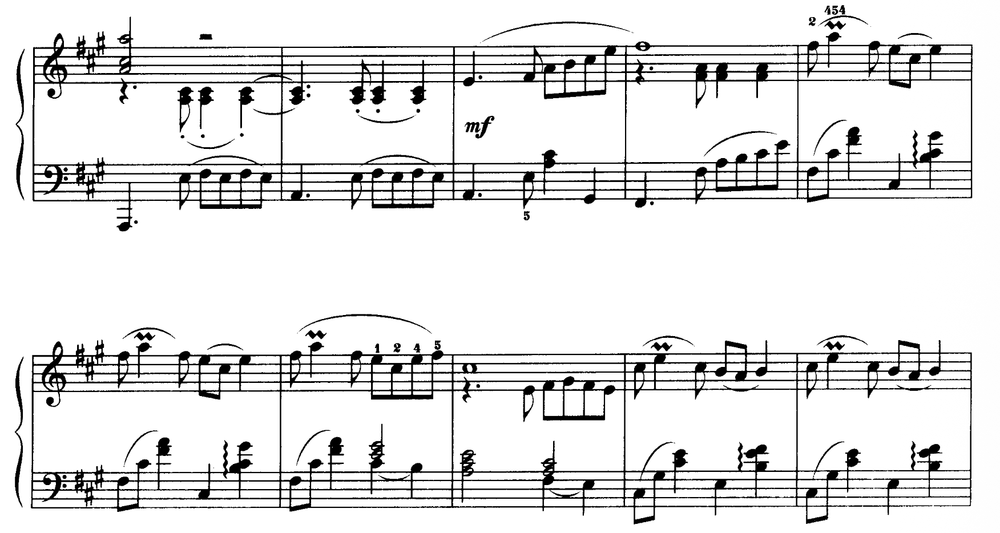

德彪西「版画集」“塔”：（B调的五声调式）

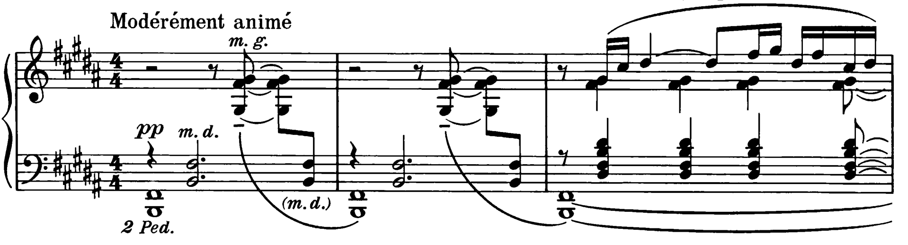

优美的旋律通常由五声调式写成。「千千阙歌（原曲：夕焼けの歌）」的副歌使用E调的五声调式：

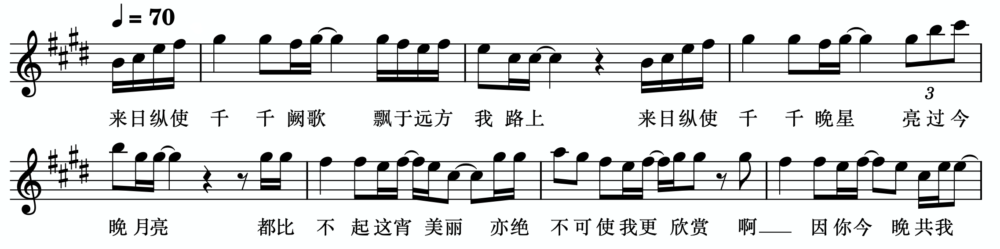

罗大佑「童年」使用A调的五声调式：

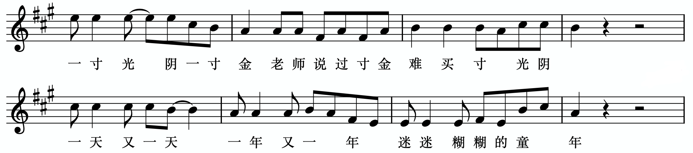

> 钢琴上的五个黑键恰好构成F$\sharp$调的五声调式。

## 日本调式

### 都节调式

`C E F A B C`是C调的都节调式。都节调式中，出现了两个小二度（E F，B C），还包含一个增四度（F B），这成为日本民歌鲜明的色彩。

日本民歌「さくら」：

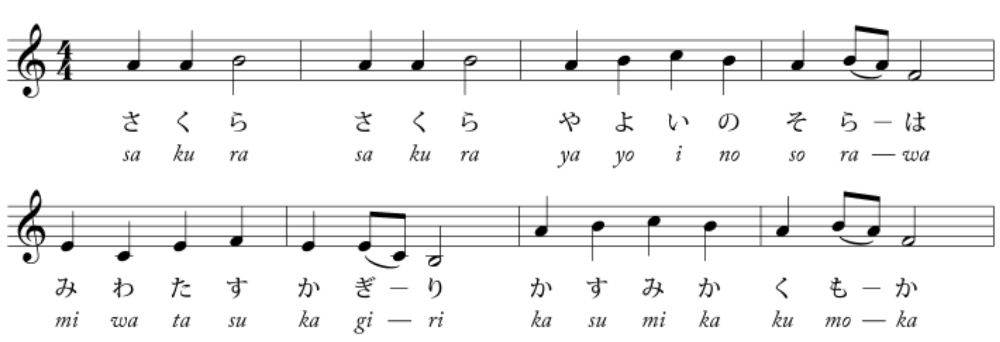

### 琉球调式

C E F G B C称为以C为主音的琉球调式，它在C大调自然音阶的基础上去掉了第二级音和第六级音。琉球调式主要应用在日本冲绳的民谣音乐中，有一种海岛、阳光的明媚听感。注意到，琉球调式中保留了日本特色的增四度音程（F B）。

琉球调式可以看作中国传统羽调式的“阳化”。以C为主音的羽调式音阶为：C $\flat$E F G $\flat$B C。把其中的$\flat$E和$\flat$B升高半音（变得明朗）就得到了琉球调式。 

## 蓝调

蓝调(blues)又称为“布鲁斯”。以E为主音的蓝调音阶为A C D $\sharp$D E G A。蓝调音阶最突出的特征就是上面的$\sharp$D，它称为蓝调音符(blues note)。

蓝调音阶可以看作是在中国五声调式（羽调）A C D E G E的正中间插入了半音$\sharp$D。蓝调音符$\sharp$D与周围两个音形成小二度，有不和谐的听感，带给人慵懒、松散的感觉。蓝调音符具有向两边音符解决的倾向，一般较少直接连接更远的音符。

在蓝调音乐的表演中，有时不会演奏精确音准的蓝调音符，而是带有一点微分音上的偏差，进一步加强慵懒、松散的氛围。

## 变化音阶

属和弦可以通过升降五音或九音变换色彩。如果我们抛掉属九和弦原本的五级音和九级音，加入所有的四个变化音，我们得到了一个音阶，这个音阶就称为变化音阶(Altered Scale)：

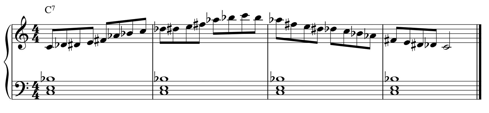

变化音阶高度半音化，产生不协和的听感。并且它剔除了主音上方的纯五度，因此产生不稳定的听感。与混合利底亚音阶相比，它更具有现代感。

同时，从属和弦向主和弦解决的角度看，因为音阶中存在$\sharp D$和$\sharp F$，它相比于混合利底亚具有更强烈的解决到主和弦的倾向。

有时为了方便记忆Altered Scale，可以把它看作“第二级音分裂为了上下半音的全音阶”，也可以把它看作“主音升半音后的旋律小调音阶”。

## 有限移位调式

一个自然音阶（大调或小调）经过移位(transposition)以后一定会产生与移位前不同的pc set。换言之，自然音阶存在12种不同的移位。根本上，这源于自然音阶在音程结构上缺乏对称性（比如自然大调音阶的音程结构是`+2+2+1+2+2+2+1`）。也正因如此，调性才得以建立。

通过构造具有对称性的音程结构，我们会得到一些移位数小于12的音阶。梅西安将其称为“有限移位调式(modes of limited transposition)”。以全音阶为例，这个音阶从任何一个音出发都是对称的，因此不再有主音的概念。“有限移位”的对称性可以起到消融主音、模糊调性的作用。对称性正是无调性音乐里的一个重要概念，它使得音与音之间失去了强烈的倾向性。

> 梅西安(Messian)特别强调作曲时“旋律”的重要性。他说：“Supremacy to melody!（ 旋律至高无上！）”。他的写作宗旨就是旋律性的。他认为和声是由旋律所需并由旋律所生的。

增四度音程、增三和弦、减七和弦都具有有限移位结构，但是音符太少一般不认为构成“调式”。纯四度叠置超出了八度的范围，一般也不认为构成调式。排除这些以后，可以被称为“有限移位调式”的排列共有7个：

### Mode 1

第一个有限移位调式就是全音阶（`+2+2+2+2+2+2`）。全音阶只有两种移位。

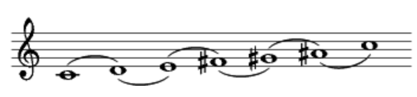

德彪西因为在乐曲中广泛使用全音阶而出名（梅西安对德彪西的音乐非常推崇）。例如他的前奏曲「帆」：（原位的全音阶）

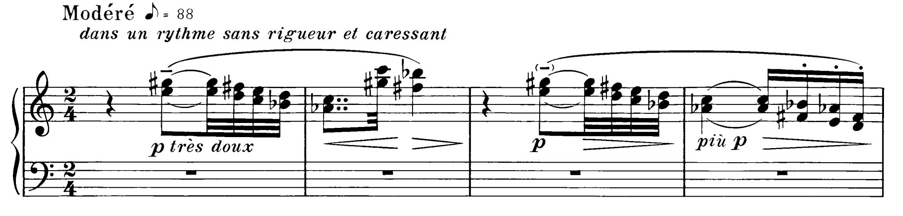

德彪西「欢乐岛」：（移位的全音阶）

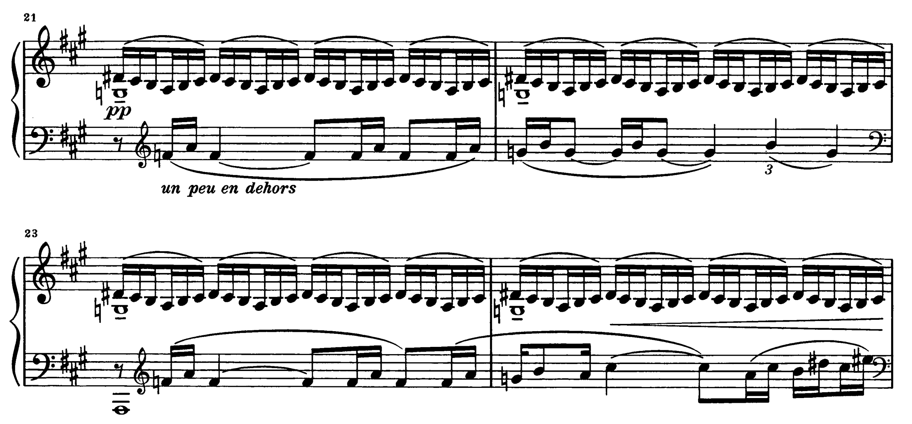

梅西安「时间终结四重奏」的第六乐章“七只号角的狂怒之舞”的开始部分的旋律以全音阶为基础，用附加音$\natural$B使其更加半音化：

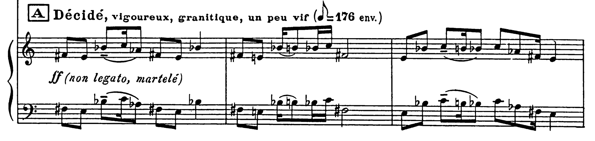

### Mode 2

第二个有限移位调式也称为“八音音阶(octatonic scale)”（`+1+2+1+2+1+2+1+2`）。它可以看作每个`+1+2`为一组分成了四组，移位超过$1+2=3$个音程就会发生重复。因此Mode 2共有3种移位。

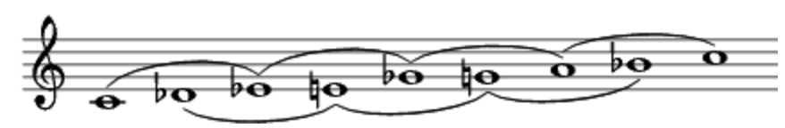

梅西安「时间终结四重奏」第六乐章的下面这个片段使用了Mode 2的原位：

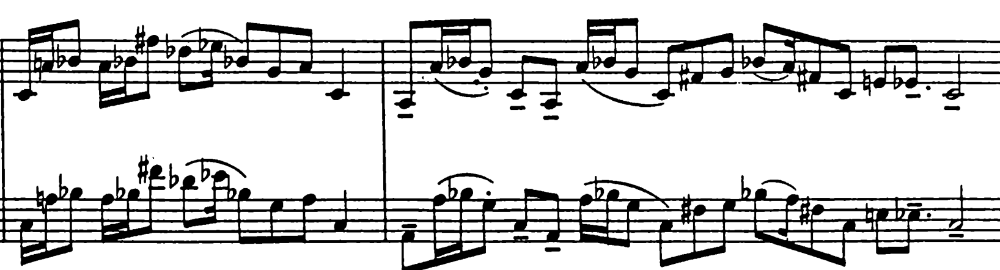

### Mode 3

第三个有限移位调式是`+2+1+1+2+1+1+2+1+1`。它可以看作每个`+2+1+1`为一组分成了三组，共有4种移位。

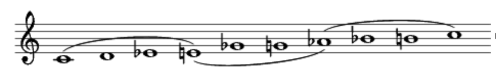

### Mode 4

第四个有限移位调式是`+1+1+3+1+1+1+3+1`。它可以看作每个`+1+1+3+1`为一组分成了两组，共有6种移位。

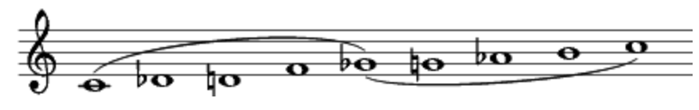

### Mode 5

第五个有限移位调式是`+1+4+1+1+4+1`。它可以看作每个`+1+4+1`为一组分成了两组，共有6种移位。

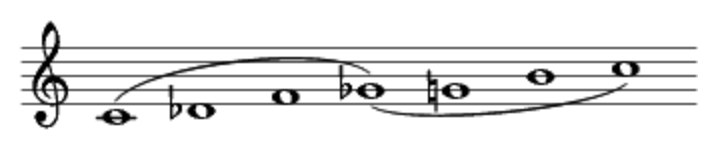

### Mode 6

第六个有限移位调式是`+2+2+1+1+2+2+1+1`。它可以看作每个`+2+2+1+1`为一组分成了两组，共有6种转位。

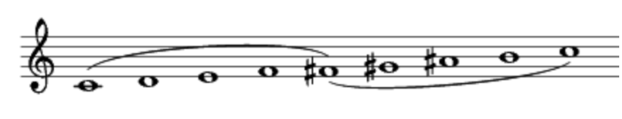

### Mode 7

第七个有限移位调式是`+1+1+1+2+1+1+1+1+2+1`。它可以看作每个`+1+1+1+2+1`为一组分成了两组，共有6种移位。

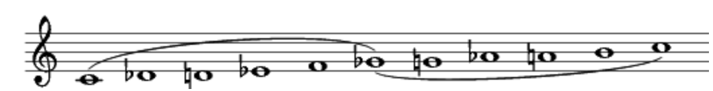

## 鸟歌

梅西安在创作音乐时，特别注重对“鸟鸣”的模仿。如他的恩师保罗·杜卡斯所言：“Listen to the birds. They are great masters.”他认为鸟鸣声创造出了极其精致的、交织在一起的“节奏持续音（rhythmic pedals）”。它们的旋律轮廓超越了人类的想象力。例如，鸟鸣声实际上包含比钢琴的半音还要小的非平均律音程。因此，梅西安表示：“死板地照搬是荒谬的”。 他不是简单地拿着录音笔去森林里记录鸟叫的实际物理结构，而是把把鸟鸣的微分音映射到十二平均律上，同时把速度放慢，以便人类的耳朵能听清其中极其复杂的轮廓。例如，《时间终结四重奏》第三乐章-鸟之深渊：

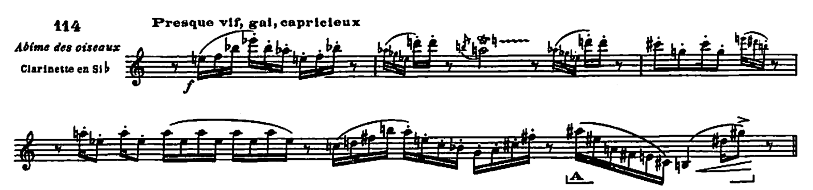

## 旋律的写作

### 目标音的装饰

在一些情况下，作曲家通常是先确定几个重要的目标音，然后在目标音上做装饰。装饰的方法同时是使用目标音上下方的半音或一度音绕来绕去。下面是一些由确定的和弦音装饰成为旋律的例子。

莫扎特K309：

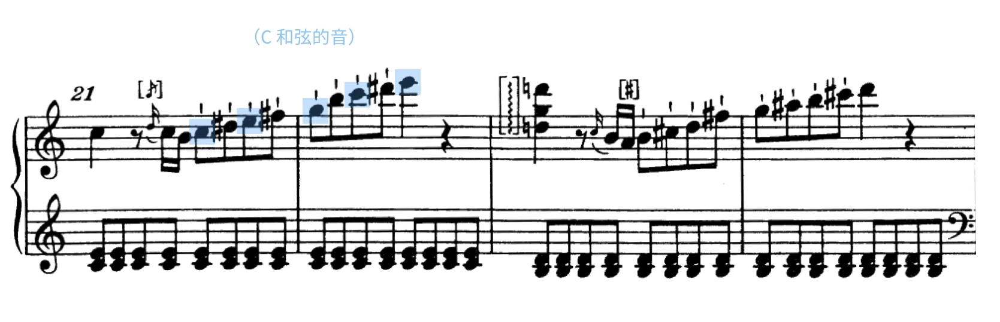

莫扎特K331：

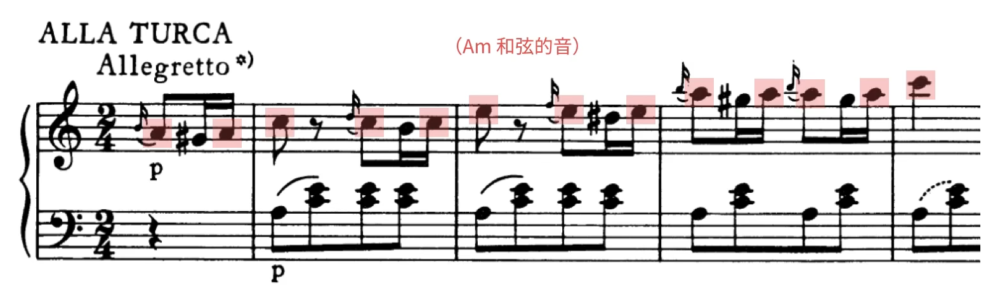

肖邦第一叙事曲：

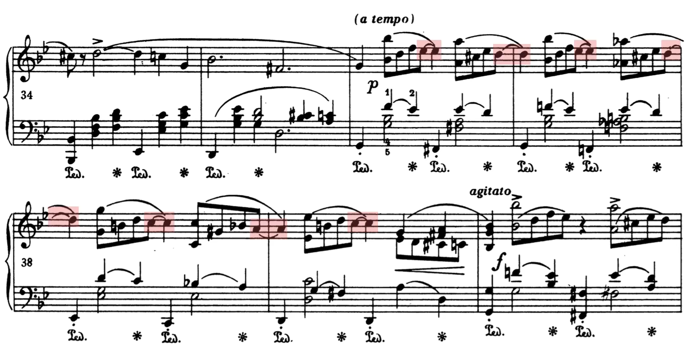

### 半音移动

偶而，你可以把除了和弦最低音之外的所有的音，全部移高或移低半音。由于这种平移是临时的而且没有动低音，一般不太会破坏和声的连续性，但是会制造出一种陌生感，产生耳目一新的效果。

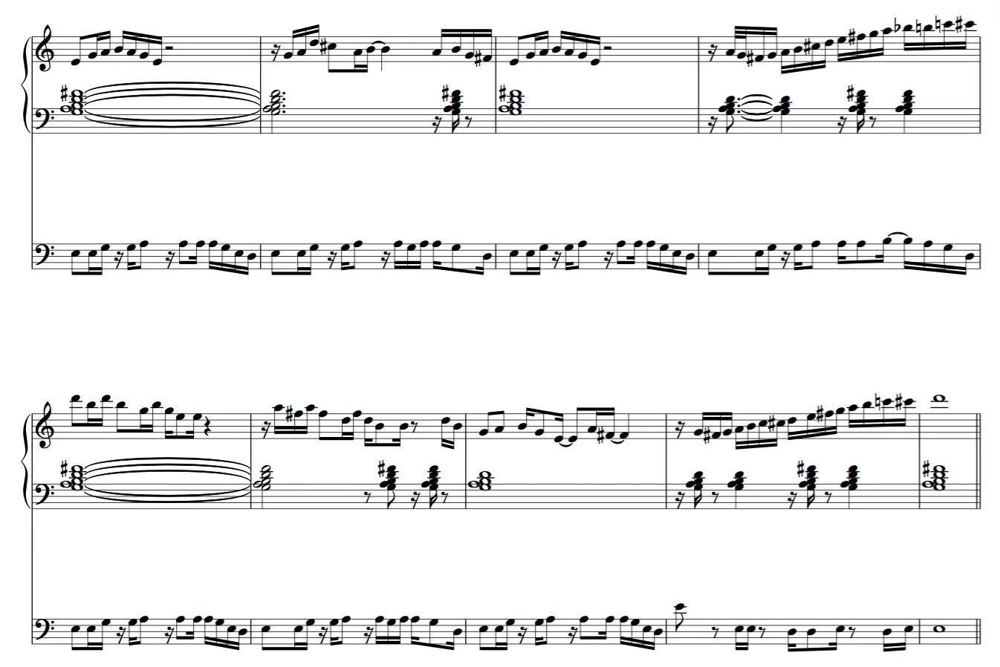

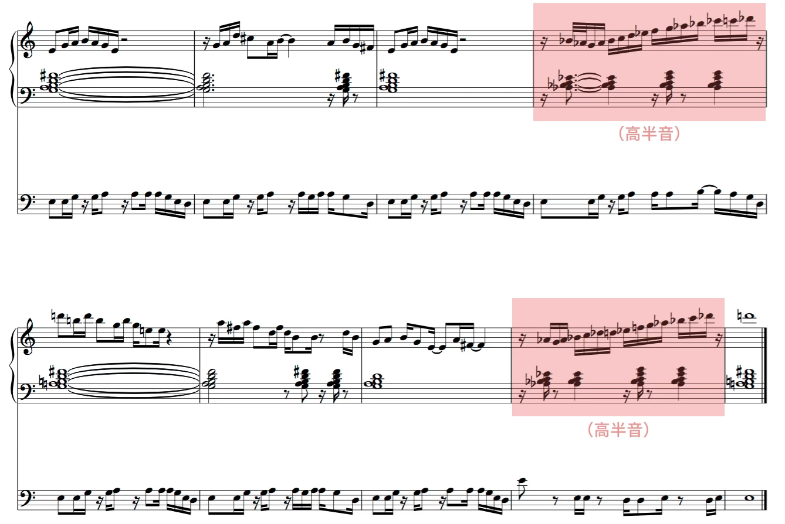

## 参考资料

[1] Fang Man - 上海交通大学2026春，音乐风格与作曲技法
