[^Date]: 2026.11.09
[^Title]: 色彩和声
[^Tag]: Music, Composition
[^Order]: 2

## 和弦变化与附加音

传统古典和声多用纯正的三和弦，其余的音被视为和弦外音。古典和声里所有的“和弦外音”都被视为不协和、不稳定的。它们出现后，必须按照严格的规则“解决”到稳定的和弦音上。随着音乐的发展，作曲家逐渐突破这一限制，把和弦的各种变化形式以及附加在和弦上的音视为一种“色彩(color)”。在色彩和声里，可以任由和弦外音飘在空中，“既不需要准备，也不需要解决”，它们“不再走向任何地方，在和弦里平静地安家落户”。借用梅西安的比喻，附加音就好像“停在花上的蜜蜂”：蜜蜂不是花的一部分，但它停在花上非但没有破坏这朵花，反而为整幅画面增添了生机、动感，“一种新的香气和风味”。我们之所以不会认为蜜蜂破坏了和谐，是源于大脑对某些附加音本身具有天然的这熟悉感。例如，德彪西作品中的附加音大量来源于弦长振动的“高阶泛音列”，它们在声学上原本就隐藏在根音的共鸣中，德彪西只是把这些自然界原本就有的“隐形色彩”在钢琴上放大了。

### 附加二音与附加四音

传统和弦的基本构成是三度叠置。附加二音相当于和弦的九音，附加四音相当于和弦的十一音。将它们从三度叠置上下移八度，形成的织体略不同于九音和十一音，它们产生较纯正三和弦而言更为柔和的听感。

在现代流行音乐中，经常使用`add2`和`add4`往往会营造一种更为“流行”的听感，与纯净和弦的“古典”听感相对比。把小三和弦升级为小七和弦也会产生类似的效果。

「夜的钢琴曲」第五首使用大三和弦`add2`和小七和弦的分解琶音来伴奏：

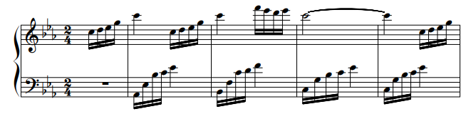

林俊杰「江南」的开头使用小七和弦`add2`：

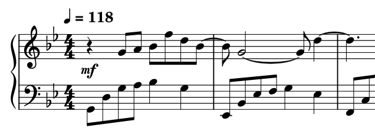

附加二音或四音时，还可以省略三音，改用`sus2`和`sus4`。它同样不会带来功能上的明显变化，但可以带来一些微妙有趣的装饰。这种装饰通常可以用在连续多个相同和弦，但又需要变化的情景。

### 附加六音

附加六音常用于大和弦上。附加六音相当于和弦的十三音。大和弦附加六音，从音的构成上相当于关系小和弦的七和弦第一转位。以`C`大三和弦为例，`add6`相当于`Am7`的第一转位。

附加六音不会改变和弦的功能。由于它的存在已经使大和弦接近于五声音阶，所以可能会有中国风的听感，同时带有类似大七和弦的清澈感。在想要使用大七和弦增加清澈感，但是旋律音却是和弦根音时，此时大七和弦的最高音和旋律音之间会产生小二度的冲突。此时一个解决方法就是把七度音替换为六度音，也能取得类似的效果。

大和弦附加六音使音的构成接近于五声音阶，因此可能带有东方的色彩。德彪西的「亚麻色头发的少女」中多次使用`add6`：

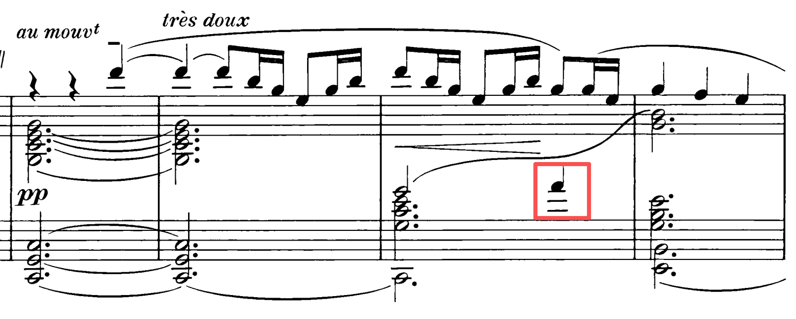

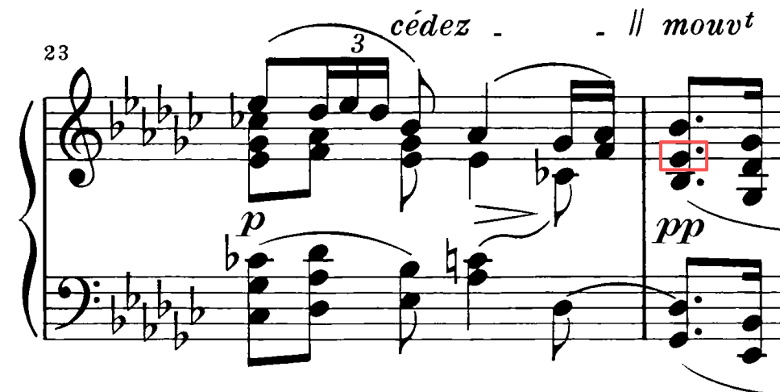

`Cadd6`再额外增加九度音，称为C69和弦。同样具有和大七和弦类似的明亮、柔和且带有一点不和谐色彩。

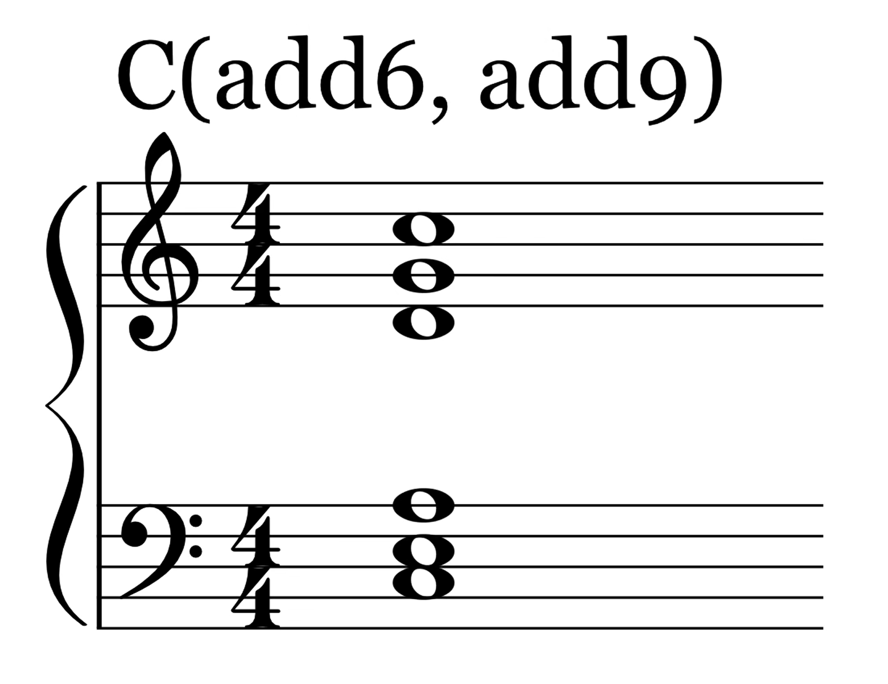

【例子TODO】

### 附加增四度

当低音C的弦震动时，泛音列中出现F$\sharp$：

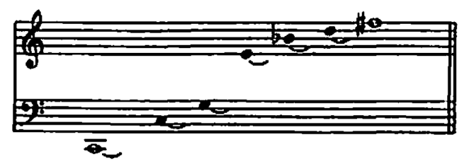

所以，根音上方的增四度也成为了一种可以被放大的“隐形色彩”。它可以和add6同时使用，并解决到`C`：

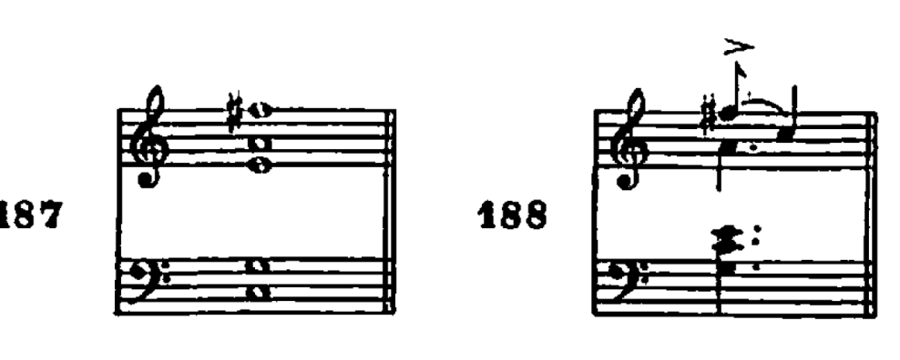

### 大和弦的变化

大和弦的第十一度音会和第七度音之间形成增四度。为了规避这种听感，使用大十一和弦或大十三和弦时，除了可以省略十一度音，通常的做法是把第十一度音升高半音。这样的和弦在爵士音乐中使用较多：

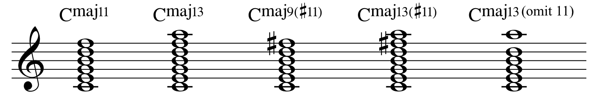

### 小和弦的变化 

小九和弦及以上，如果没有使用好的排列法，听感会比较差。常见的排列法有以下几种。

第一，最低音降低一个八度：

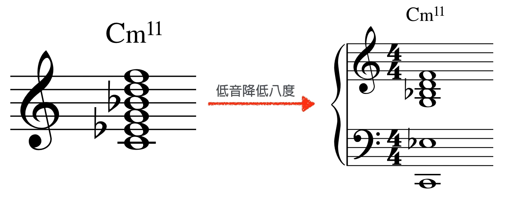

第二，最高音和最低音都降低一个八度：

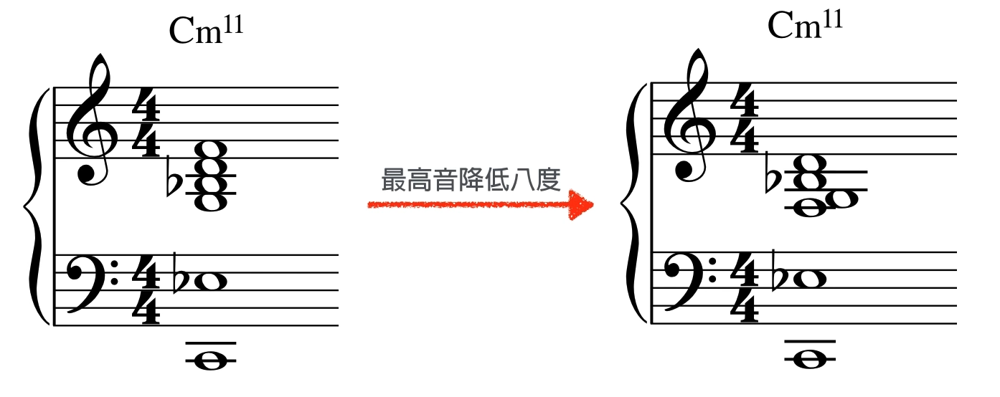

第三，一种比较开放的排列法：

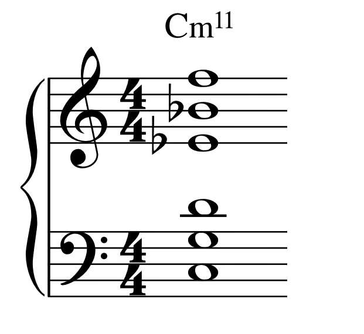

久石让「风之谷」开头的小九和弦使用了第三种排列法：

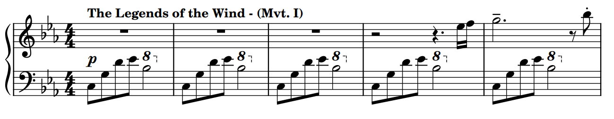

如果觉得小十一和弦的梦幻感太重，可以尝试省略九度音，这样也就变回了小七和弦附加四音。

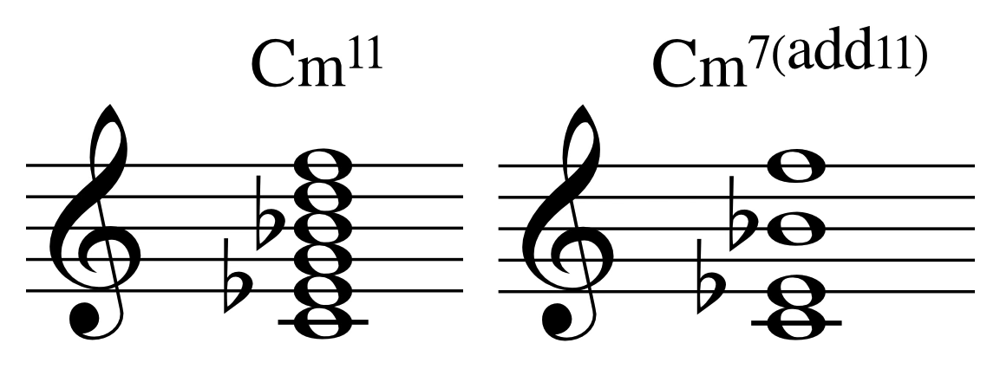

### 属和弦的变化

在属和弦里，为了增加听感的变化，我们通常可以对其五级音或九级音进行上下半音的变化。这产生了以下八种属九和弦的变化：

### 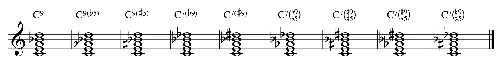

> 这一变化形式引入了“变化音阶”的概念，见[旋律-变化音阶](/post/1g7kd6/#变化音阶)。

在终止时，可以在五级和弦上使用“属十一和弦”来模糊听感，使终止不那么锐利。同时，因为属十一和弦的三音和十一音之间只差半音，所以通常省略三音。此时的`G11(omit3)`恰好是`Dm7/G`。如果把五度音也省略，那么`G11(omit3,5)`就变成了`F/G`。这两种正格终止在流行音乐里广泛使用。为了配合属和弦的复杂度，可以把`C`扩展为`Cmaj9`或`Cadd2`。

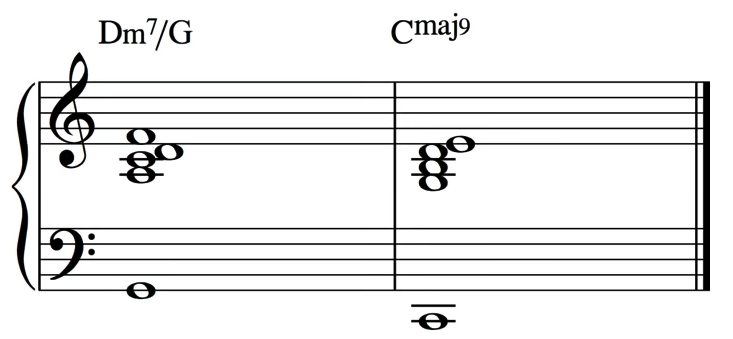

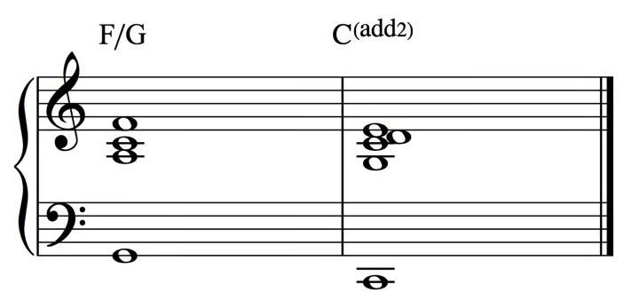

如果追求比较“爵士”的听感，五级和弦会使用“属十三和弦”。这种情况下我们通常要省略一些音。属十三和弦最常见的省略音的模式是以下三种：

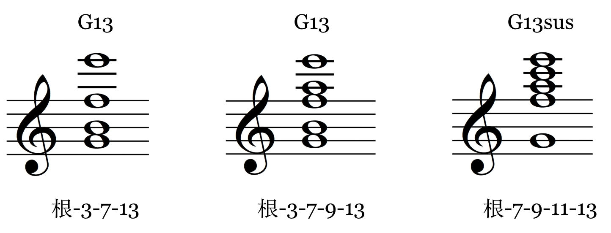

### 减和弦的变化

要丰富减七和弦纠结的听感，可以添加升五音或大七度音：

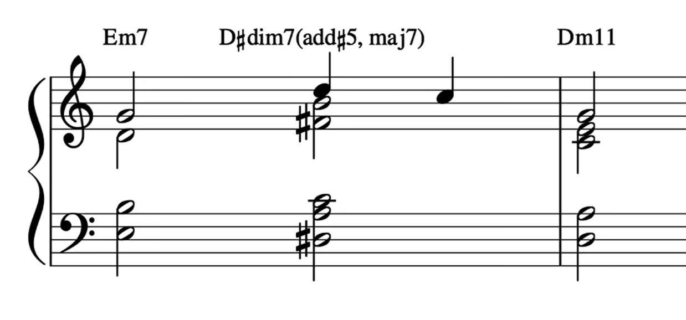

## 悬浮的调性

传统古典和声建立在“紧张–解决”的张力之上，其核心是属到主（`V–I`或`V–i`）的解决：导音上行、属七和弦增四度的解决、根音下行五度，等等。这些进行具有强烈的推动力，并由此确立稳定的调性中心。根据和弦距离解决到主的距离，可以为和弦确立一个“和声功能”，这就是传统和声的“逻辑”。这种张力关系贯穿和弦连接、乐句终止与整体调性布局等多个层次。

而十九世纪末，作曲家开始削弱对调性的强调。和弦不再为某一种“功能”而服务。和弦的构成（协和或不协和的）为和弦所产生的音响本身服务，称为和弦的“色彩”。和“功能和声(functional harmony)”形成对比，这样的作曲技法称为“色彩和声(chromatic harmony)”。在传统和声里，不协和的音程需要被解决，解决带来音乐前进的动力。而当“不协和”成为一种色彩时，它就不再是必须被解决的了。

瓦格纳「特里斯坦与伊索尔德」的前奏曲的开头的和弦`F-G#-B-D#`在和弦构成上属于导七和弦，但它没有像传统的导和弦那样解决到`G♭`，而是进行到了`E7`。这里的导七和弦是一种色彩，而非指向`G♭`的推动力。在「特里斯坦」里，这个导七和弦的紧张一直没有被解决，直到最后一幕“爱之死”。调性迟迟没有被建立，而是悬浮在未被解决的紧张色彩中。

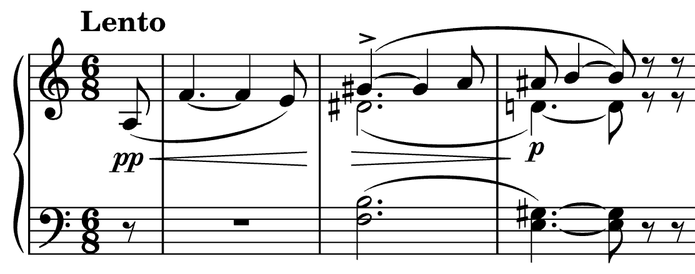

萨蒂「裸体歌舞」虽然在记谱的时候选择了D大调的调号，但是在乐曲开始后的很长一段时间里，和声只在`Gmaj7`和`Dmaj7`之间来回摇摆，并没有`A`到`D`的解决为之建立调性。同时，`Dmaj7`虽然可以看作`G`的属和弦，但由于`C#`的存在，它也天然不具有解决到`G`的倾向。在这里，大七和弦的不协和音程（大七度）并不是为了解决而存在，而是作为一种色彩存在。音乐在两种色彩之间漂浮，并没有一个明确的目的。

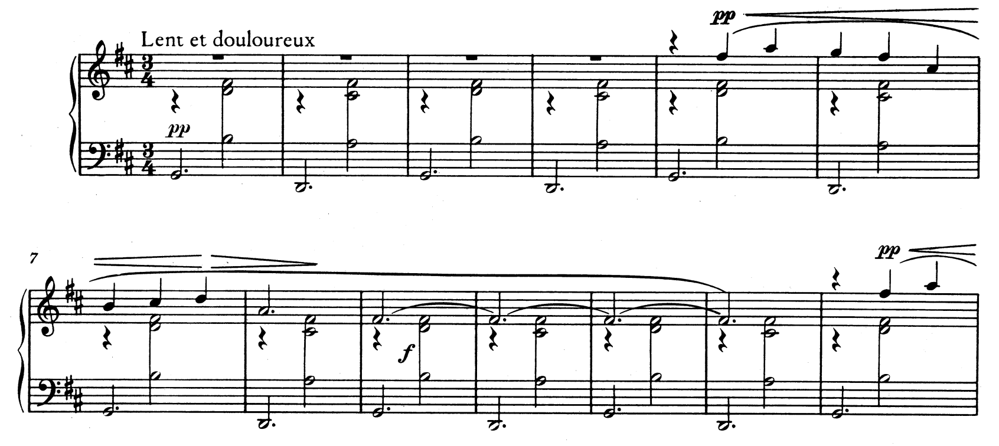

## 和弦滑行

传统古典和声强调声部的独立性和反向运动，四部同向是严格禁止的。而当浪漫主义后期，和弦融入大量附加音（七音、九音/附加二音、十一音/附加四音、附加六音、附加增四度），随着音符越来越多，传统的保持声部独立性和避免反向的规则反而会造成对位上的混乱。

德彪西和拉威尔常使用用“和弦滑行”（planing，plane即动词“滑行”）的手法，既能保留复杂和弦的丰富色彩，又能保证音乐线条的清晰度。和弦滑行分为两种，一种是在选定音阶上的“相对滑行”；一种是保持和弦绝对音程的“绝对滑行”。

相对滑行会使得和弦内部的音程发生一定的改变，色彩会产生变化（例如大和弦滑成了小和弦）。德彪西的前奏曲「枯叶」：

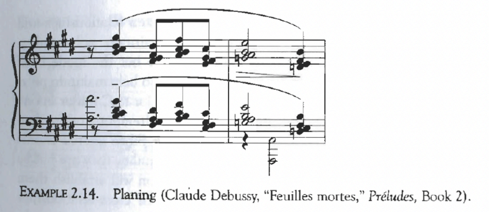

绝对滑行使同一种色彩在不同调性中接连呈现。德彪西的「格拉纳达之夜」：

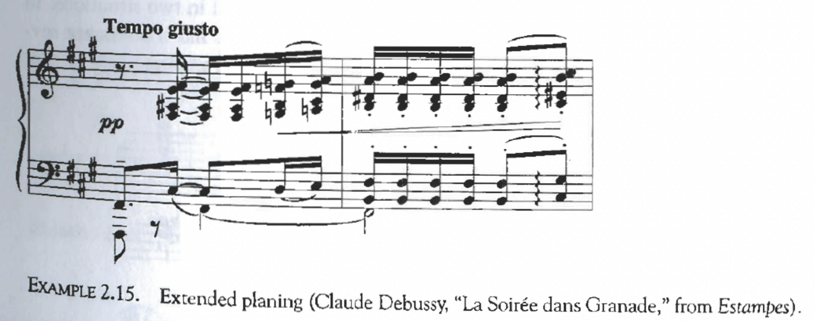

德彪西前奏曲「亚麻色头发的少女」中，在和弦滑动过程中通过保持同一个pc set来使色彩保持不变：

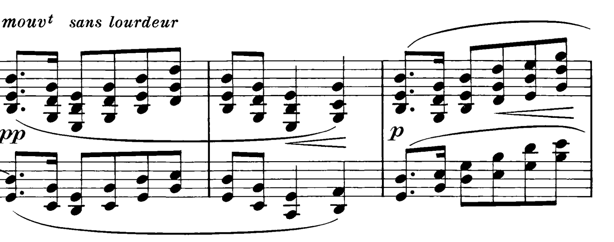

## 色彩三度进行

根音做“三度进行(mediant progression)”是调性和声的常见和弦进行。在传统调性和声里，和弦的构成音从音阶中取，这造成三度进行时和弦的大小性质会发生改变。以C大调为例，`C-Am-F-Dm`的根音恰好呈三度下行，同时大和弦和小和弦交错。根音三度进行听感平稳、连接感强，很大程度上源于相邻的和弦共享两个共同音。

而在浪漫主义晚期时，会使用“保持和弦的大小性质不变”的根音三度进行。这是一种色彩三度进行(chromatic mediant progression)。例如，`C-A-F-D`是大和弦色彩的色彩三度进行；`Cm-Am`则是小和弦色彩的色彩三度进行。大和弦色彩的色彩三度进行经常用来营造一种戏剧性的调性漂移。

德彪西「月光」第27小节在D$\flat$大调建立的前提下，由`F♭`大和弦接回`D♭`大和弦，属于大和弦色彩的色彩三度进行：

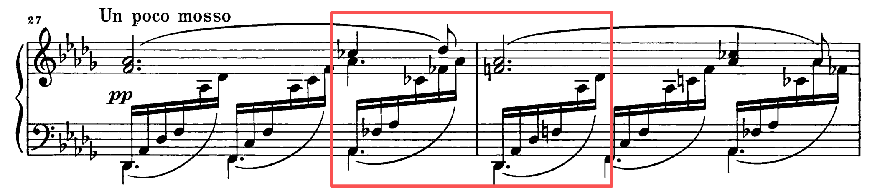

从宏观上看，「月光」继而把这种从`D♭`向`F♭`（`E`）的离调运动发展为了调性的整体平移——从37小节开始，音乐转到`E`大调：

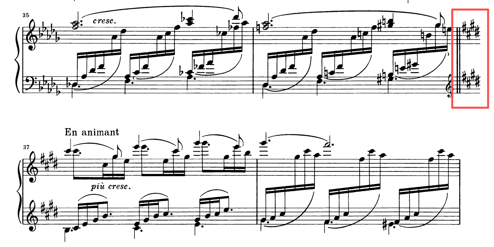

在下面这个李斯特的作品例子中，`B♭-G`以及后面的`C-A♭-F`就是保持大和弦的色彩三度进行：

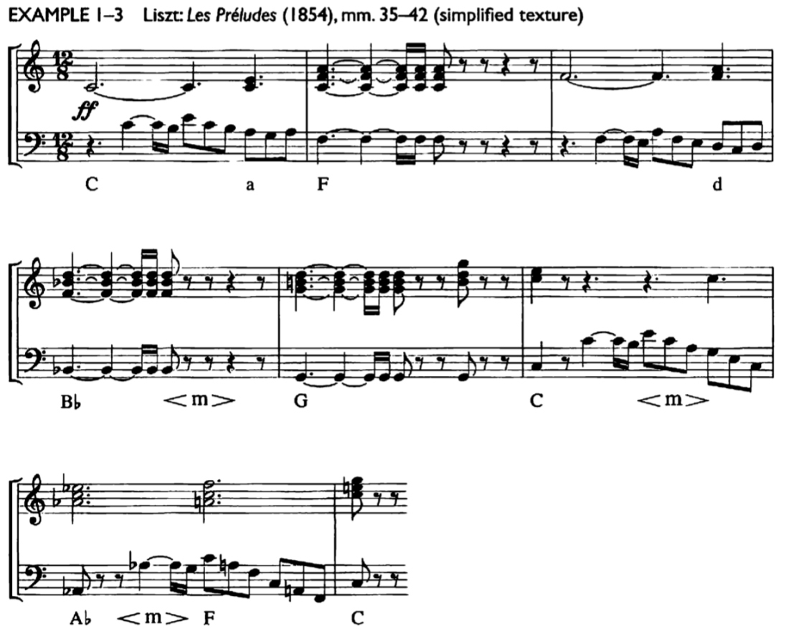

## 分裂和弦

把两个具有2个共同音的三和弦用形如下面的方法融合成为一个和弦，就构成“分裂和弦(split chord)”：

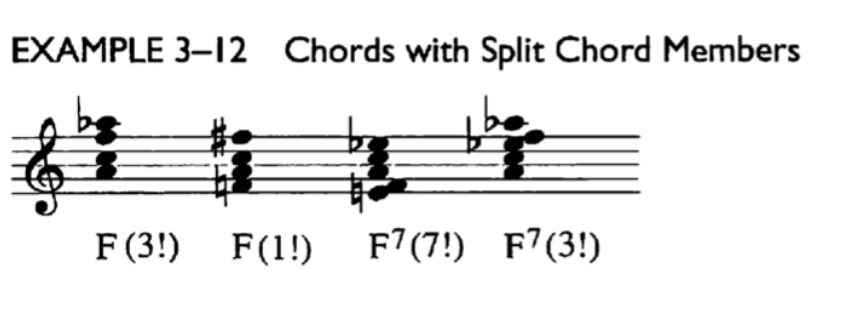

在上图中，`F`与`Fm`拼成`F(3!)`；`F`与`F#dim`拼成`F(1!)`，`Fmaj7`与`F7`拼接成`F7(7!)`，`F7`与`Fm`拼接成`F7(3!)`。

拉威尔的「镜子组曲」中，使用了`G`与`G#dim`拼接成的`G(1!)`：

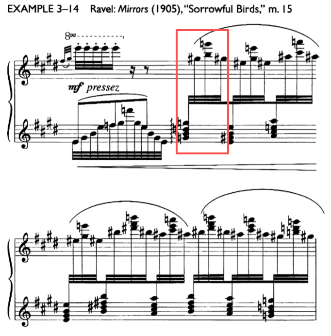

## 空五度

空五度(open 5th)，也即“省略三音，只保留根音和五音”。空五度是自然音阶interval vector里出现最多的音程，它携带的调性信息就很少，因此带有模糊调性的色彩。同时，由于没有三音，也无法从情绪上区分“大和弦”与“小和弦”，三音的空缺本身形成了一种独特的色彩。

德彪西「沉没的大教堂」的开头：

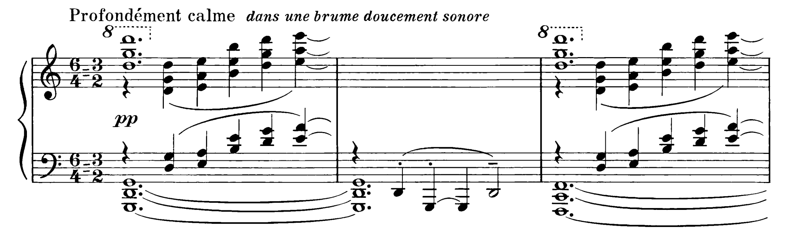

德彪西「欢乐岛」的中间段，每小节只使用一个空五度和弦，仅凭织体创造出绚丽的音响：

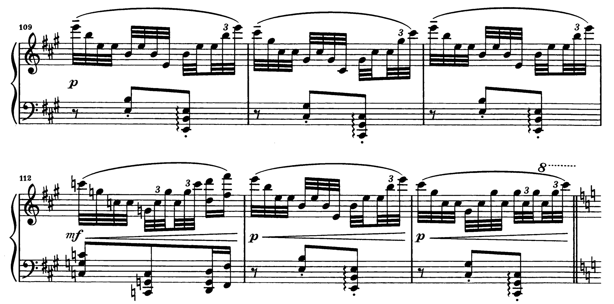

## 四度叠置 & 五度叠置

传统调性和声以三度为基础堆叠。如果改用四度或五度堆叠，也构成一种色彩和声。例如：

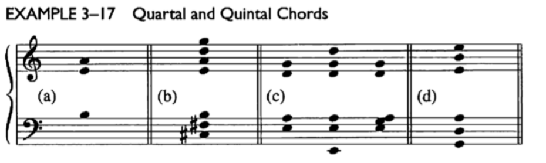

通常，我们用纯四度或纯五度来堆叠。以科普兰的作品为例：

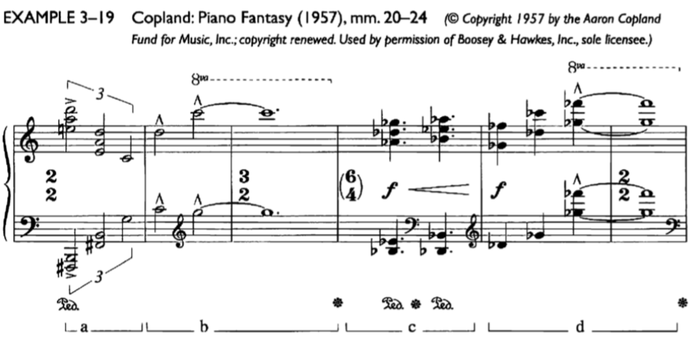

纯四度向上堆叠可以制造出一种压力逐渐增大、仿佛永无止境的听感。

## 二度叠置（次和弦）

基于二度堆叠的和弦，称为次和弦(secundal chords)，听感类似音块(cluster)：

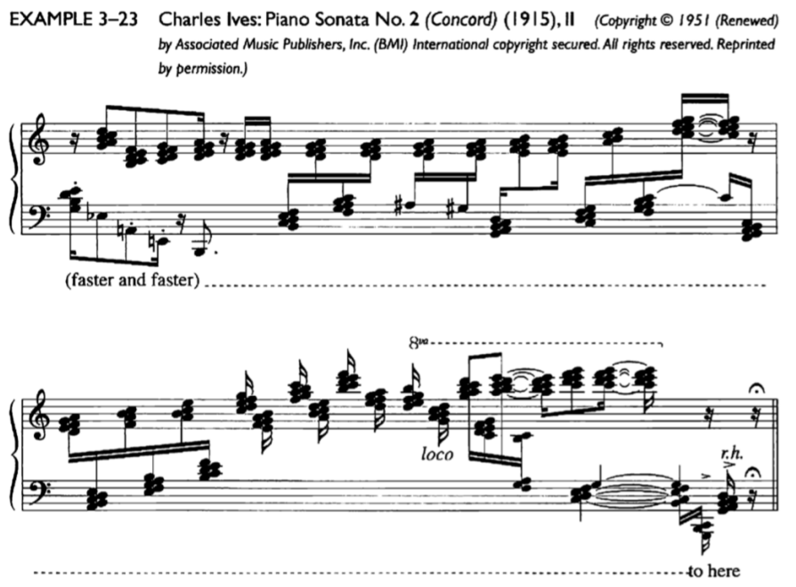

## 全音阶和弦

取材于全音阶的全音阶和弦(whole-tone chords)也构成了一种全新的色彩：

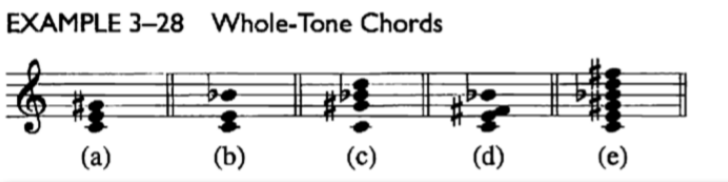

以斯克里亚宾的练习曲为例：

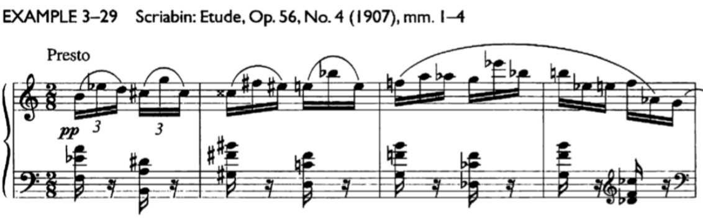

## 复和弦

用两个没有共同音的和弦构成复和弦(polychords)。例如：

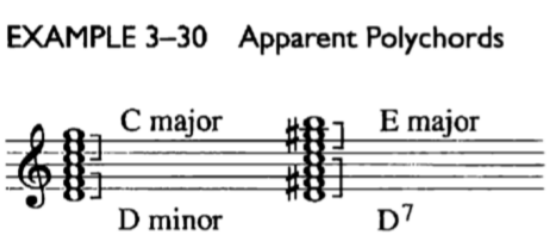

斯特拉文斯基「春之祭」第一幕“春之预兆”：`E`+`E♭7`

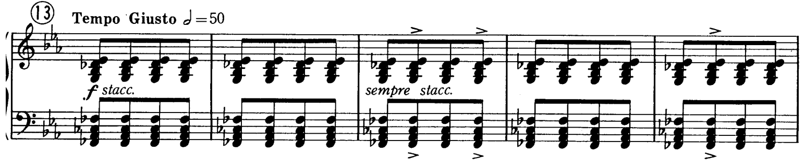

斯特拉文斯基「彼得鲁什卡」：`G`+`F#`

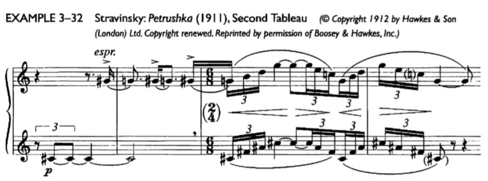

爵士音乐里，经常会在在一个省略五音的属七和弦上任意叠一个三和弦。没有一套固定的理论来告诉我们属七和弦上方叠加什么三和弦效果会比较好。通常，这样的做法的目的就是带来一种复杂、纠结的听感。在此基础上，还可以省略属七和弦的最低音，制造一种更飘逸的听感。爵士音乐还会经常使用这种复和弦连续半音向下的（绝对）滑行。

## 斯克里亚宾的神秘和弦

属十三和弦`C13`本来就可以看作复和弦`C7`+`Dm`。升高十一音，得到`C7`+`D`。再降低九音，得到`C7`+`F#m`。这两个和弦被斯克里亚宾称为“神秘和弦(mystic chord)”。它在使用时不被用作属功能，而是被斯克里亚宾发展为了一种独特的色彩。使用时通常省略五音，并使用四度叠置：

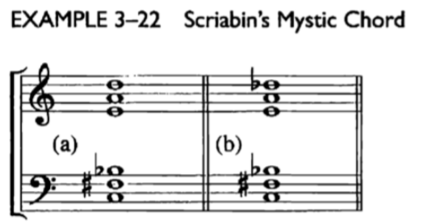

## 有限移位调式上的和声

确定一个[有限移位调式](/post/1g7kd6/#有限移位调式)以后，可以直接在该调式上构造和弦进行。这样可以保持和弦的色彩与调式一致。以Mode 2为例：

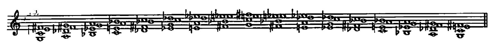

## 卢托斯瓦夫斯基的音程配对

卢托斯瓦夫斯基(Lutoslawski)用字母A到K（跳过了I）来标记十种特定的四音和弦：

`A`：`[0,3,6,9]` - `+3+3+3`（减七和弦） 
`B`：`[0,3,6,10]` - `+3+3+4`（半减七和弦） 
`C`：`[0,3,7,10]` - `+3+4+3`（小七和弦） 
`D`：`[0,4,7,10]` - `+4+3+3`（属七和弦） 
`E`：`[0,3,7,11]` - `+3+4+4`（小大七和弦） 
`F`：`[0,4,7,11]` - `+4+3+4`（大七和弦） 
`G`：`[0,4,8,11]` - `+4+4+3`（增七和弦） 
`H`：`[0,3,8,11]` - `+3+5+3`（分裂和弦`C`+`Cm`） 
`J`：`[0,3,6,11]` - `+3+3+5`（分裂和弦`E`+`Edim`） 
`K`：`[0,5,8,11]` - `+5+3+3`（分裂和弦`Am`+`Adim`）

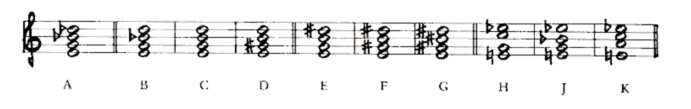

可以看到，A~G由`3`个或`4`个半音的interval堆叠而成；H,J,K由`3`个或`5`个半音的interval堆叠而成。是卢托自创的七和弦，由两个+3和一个+5堆叠而成。

卢托会这样使用这十个和弦来形成他独特的和声色彩：在高声部、中声部、低声部分别使用以上十个和弦，并用到全部的12音。例如：

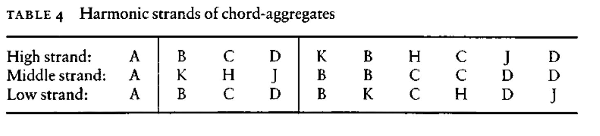

用音符写出来如下：

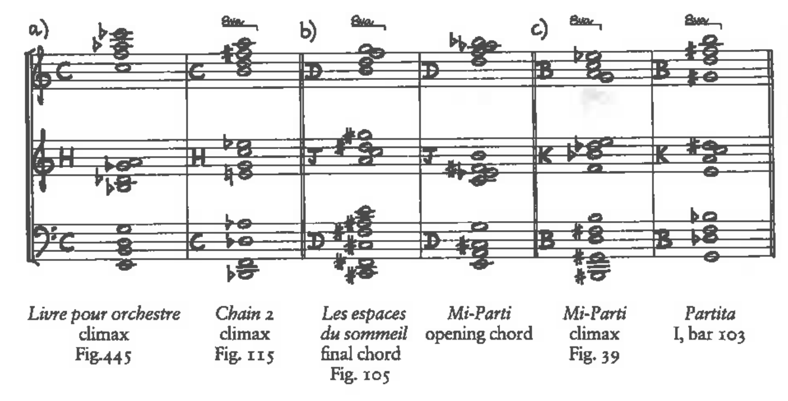

上面这种配置12音和弦的方法，如果使用得当，可以把任意两个相邻和弦音之间的音程控制在$\{3,4,5\}$这样一个小集合上。他继而推广了这种做法：用固定的若干种音程来堆叠和弦，把这样构造和弦的方法称为“垂直音程配对(vertical interval pairing)”。

首先固定音程集合，以$\{4,5\}$为例。从根音出发向上以4个半音或5个半音堆叠，可以找到若干种产生不重复的12音的排列。这样的排列会具有独特的色彩，因为它们在音程上是一个非常简单的数学结构。以下是卢托常用的12音interval pairing色彩和弦：

> 注意，这里的4和5是指interval class。相邻音程不仅可以是4,5，也可以是12-4=8, 12-5=7。

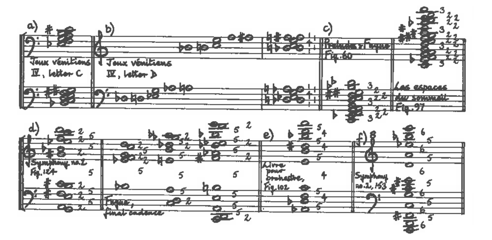

Interval pairing为我们提供了一个理解色彩和弦的新的数学视角。全音阶和弦(`+2`)、减七和弦(`+3`)、增三和弦(`+4`)、纯四度叠置(`+5`)、增四度音程(`+6`)，这一类色彩是由单一音程集合堆叠而成的和弦；传统和声的三度叠置，可以看作音程集合$\{3,4\}$堆叠而成的和弦。现在，卢托找到了一种具有一致性的数学语言来描述色彩，大大拓宽了我们对色彩和声的探索。从某种程度上，现代色彩和声的发展，就是从单一的音程级和$\{3,4\}$走向更广阔的音程集合。

## 参考资料

[1] Fang Man - 上海交通大学2026春，音乐风格与作曲技法
[2] 官大为 - 好和弦
