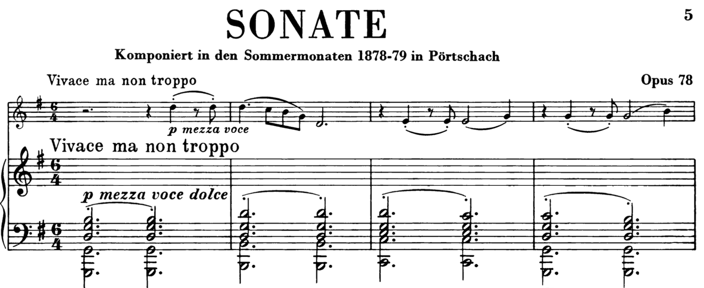

[^Date]: 2026.11.07
[^Title]: 节奏
[^Tag]: Music, Composition

## 2拍子与3拍子

最基本的节奏型是“2拍子”与“3拍子”。2和3是最小的质数，每小节大于3拍的节奏都可以拆分为“2拍”和“3拍”的组合。例如，5=2+3，7=3+2+2，9=3+3+3。

### 3-3-2

4拍子（8拍子）的一种常见分解是`3-3-2`。

「残酷な天使のテーゼ」的预副歌段落，全部使用`3-3-2`节奏型：

Evan Call在「Zoltraak」中反复使用`3-3-2`：

类似的还有李博禅「楚颂」的快板段落：

### 更多基于2和3的分解

「One Last Kiss」的引子部分把16拍分解为`3-3-3-3-2-2`：

「楚颂」快板段：`3-3-2-2 3-3-2-2 3-3-2`

还有`3-2-2 3-2-2 3-3-2 2-2-2-2`

## 在旋律中使用反拍

初学者在旋律写作时通常会有一种在强拍写音符的惯性。在强拍上写音符的确是最正常也是最广泛的做法，这通常产生庄严、前进式的效果。为了打破这种效果，我们需要在反拍上写音符。

### 延迟入场

旋律相比正拍延迟一拍入场，避免踩在正拍上。

依旧以「楚颂」快板段为例，旋律的第一拍被刻意留空：

YOASOBI「勇者」的主歌不仅进入时第一拍被留空，后面的每个音符都在反拍上：

勃拉姆斯「第一小提琴奏鸣曲（雨之歌）」第一乐章开头时，小提琴每一次都延后一拍入场，营造出缱绻的情绪：

### 抢拍入场

YOASOBI「勇者」的副歌如果从第八个音符开始抢先一个十六分音符进拍，使得旋律落在反拍上：

如果不抢这一拍，旋律全落在正拍上：

### 规避强拍的`_234`节奏型

YOASOBI「群青」的副歌，反复在强拍上留空，形成`1234_234 _234_234 _234_234 _234_234...`的结构：

米津玄師「砂の惑星」的预副歌：`234 _234_234_234_234 _234_234____...`（也可以理解为抢拍入场）

> 为纪念初音未来诞生10周年而作

### 反拍悬挂

反拍的另一种常见用法，是把“反拍段”悬挂在两个“正拍段”之间。以とあ的「ツギハギスタッカート」为例，副歌段旋律与弦乐伴奏分别出现五个音的反拍悬挂：（红框部分是被悬挂的反拍）

bridge段钢琴在中间悬挂三个反拍上的音：

YOASOBI的「アイドル」：

## 在旋律中交错使用节奏型

「残酷な天使のテーゼ」的副歌段，节奏型是`4-4 3-3-2 4-4 3-5`，在以“2拍子”为基础的节奏与“3拍子”为基础的节奏之间来回切换：

「勇者」的bridge段使用`2-3-3` + `3-3-2`

米津玄師「砂の惑星」的副歌段，节奏型反复在`o234`和`3-3-2`之间切换：

## 复节奏

多个声部之间，每个声部使用不同的节奏型，称为“复节奏(polyrithm)”。

最简单的例子是3对2：右手以2拍为单位，左手以3拍为单位

下面这个例子有三个声部，上方两个声部以3拍为单位，下方声部以2为单位

下面这个例子在每小节局部使用复节奏：第一小节右手是`3-3-2`，左手是`2-3-3`；第二小节是两手之间3对2

也可以不同声部用不同的小节线：

## 等节奏

等节奏(isorhythm)指某一个声部内部有两个循环，一个是节奏的循环（称为talea），一个色彩的循环（称为color）。Talea和color的周期可以相同，也可以不相同。

梅西安「时间终结四重奏」的第一乐章，钢琴声部由一个29个和弦的循环构成color，一个17个和弦的节奏型构成talea。17和29互质，在乐章的有限篇幅内永远不会重新对齐，营造出“没有终点”的时间感：（我用红色和蓝色标出了不同的color，用黄线分割talea）

## 不规则重音

斯特拉文斯基的「春之祭」第一幕“春之预兆”，通过标注重音记号摆脱了小节线的限制，在二拍子的框架下创造了不规则的节奏型。

> 乍一看重音分布没有规律可循，但如果以重音为界，数出每个重音紧随其后的音符个数，就会得到：9, 2, 6, 3, 4, 5, 3。可以看到，这个数列有一个单调递减的子序列9 6 4 3和一个单调递增的子序列2 3 5交错组成。其中，6 4 3的差分恰好是-2-1，2 3 5是+1+2，具有某种对称性。当然，斯特拉文斯基是否是这样计算出来的我们就永远不得而知了。然而，“由两种不同截然不同的节奏‘秩序’相互干扰产生表面上的混乱”是一种典型的斯特拉文斯基理念。

而在「春之祭」的最后一幕“献祭之舞”中，斯特拉文斯基使用了“每小节变换拍号”的方式来表示不规则节奏：

## 参考资料

[1] Fang Man - 上海交通大学2026春，音乐风格与作曲技法
[2] Wikipedia - Stravinsky
[3] 鸢梦Yumeko - 争议不断？热度还是太高了！史上最全杂谈芙莉莲OP1，带你走进YOASOBI的世界
[4] 鸢梦Yumeko - 老冰旧神！从四套三开始聊「God knows...」——希望、力量、与漫无止境的青春