[^Date]: 2026.11.07
[^Title]: 节奏
[^Tag]: Music, Composition

## 2拍子与3拍子

最基本的节奏型是“2拍子”与“3拍子”。2和3是最小的质数，每小节大于3拍的节奏都可以拆分为“2拍”和“3拍”的组合。例如，5=2+3，7=3+2+2，9=3+3+3。

### 3-3-2

4拍子（8拍子）的一种常见分解是`3-3-2`。

「残酷な天使のテーゼ」的预副歌段落，全部使用`3-3-2`节奏型：

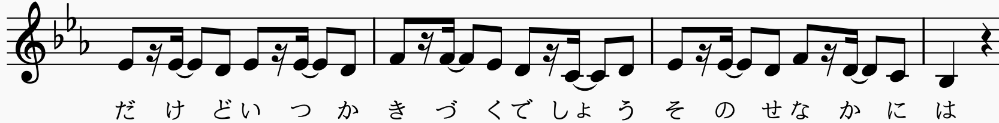

Evan Call在「Zoltraak」中反复使用`3-3-2`：

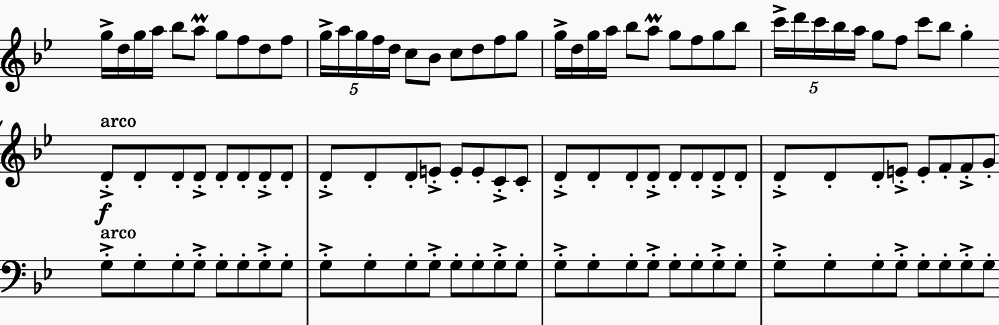

类似的还有李博禅「楚颂」的快板段落：

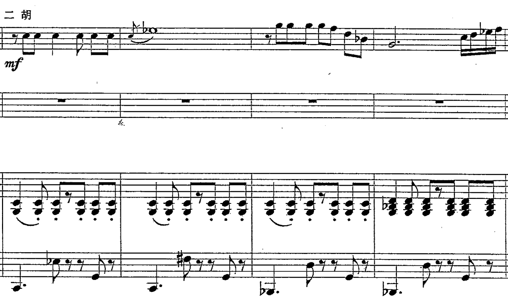

### 更多基于2和3的分解

「One Last Kiss」的引子部分把16拍分解为`3-3-3-3-2-2`：

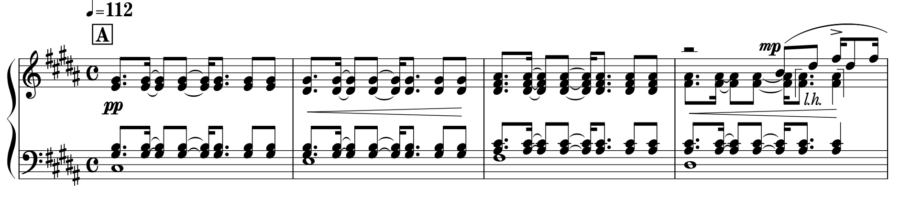

「楚颂」快板段：`3-3-2-2 3-3-2-2 3-3-2`

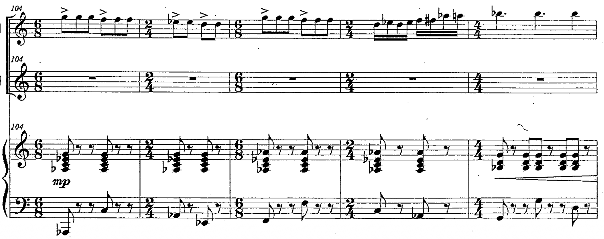

还有`3-2-2 3-2-2 3-3-2 2-2-2-2`

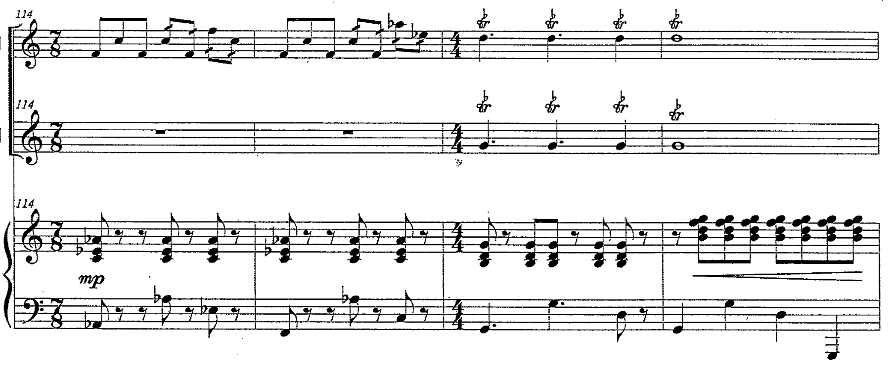

## 在旋律中使用反拍

初学者在旋律写作时通常会有一种在强拍写音符的惯性。在强拍上写音符的确是最正常也是最广泛的做法，这通常产生庄严、前进式的效果。为了打破这种效果，我们需要在反拍上写音符。

### 延迟入场

旋律相比正拍延迟一拍入场，避免踩在正拍上。

依旧以「楚颂」快板段为例，旋律的第一拍被刻意留空：

YOASOBI「勇者」的主歌不仅进入时第一拍被留空，后面的每个音符都在反拍上：

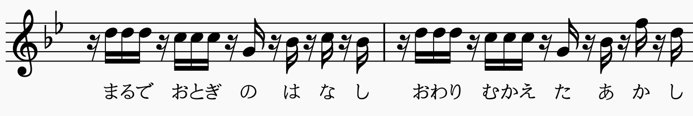

勃拉姆斯「第一小提琴奏鸣曲（雨之歌）」第一乐章开头时，小提琴每一次都延后一拍入场，营造出缱绻的情绪：

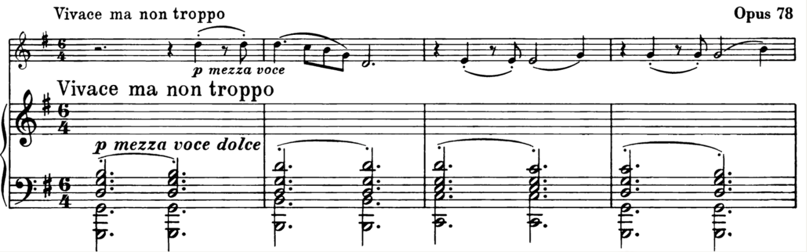

### 抢拍入场

YOASOBI「勇者」的副歌如果从第八个音符开始抢先一个十六分音符进拍，使得旋律落在反拍上：

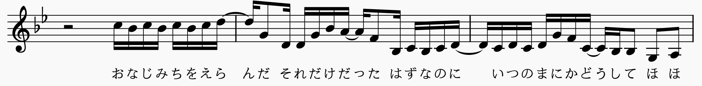

如果不抢这一拍，旋律全落在正拍上：

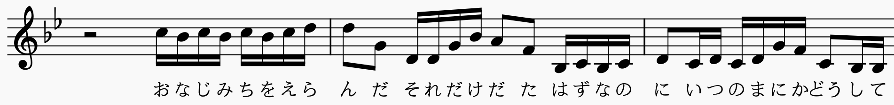

前山田健一「Zzz」的副歌抢先一个八分音符进拍，使得大多数音符落在反拍上：

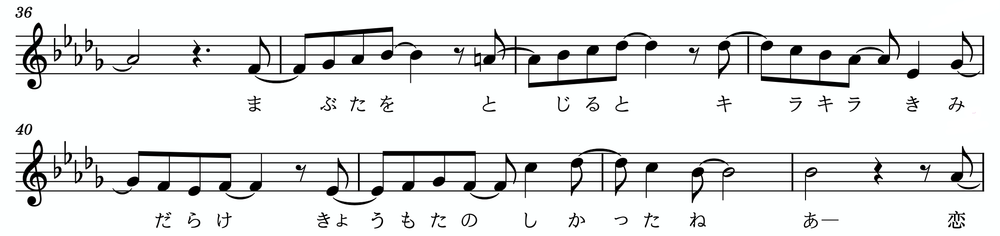

### 规避强拍的`_234`节奏型

YOASOBI「群青」的副歌，反复在强拍上留空，形成`1234_234 _234_234 _234_234 _234_234...`的结构：

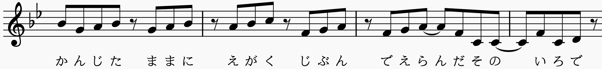

米津玄師「砂の惑星」的预副歌：`234 _234_234_234_234 _234_234____...`（也可以理解为抢拍入场）

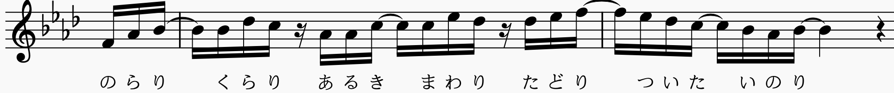

> 为纪念初音未来诞生10周年而作

### 反拍悬挂

反拍的另一种常见用法，是把“反拍段”悬挂在两个“正拍段”之间。以とあ的「ツギハギスタッカート」为例，副歌段旋律与弦乐伴奏分别出现五个音的反拍悬挂：（红框部分是被悬挂的反拍）

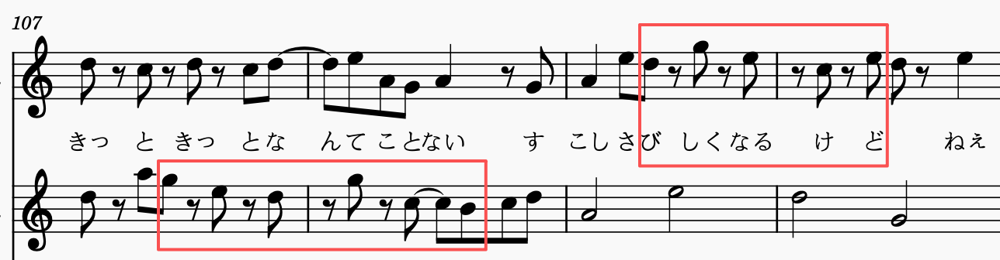

bridge段钢琴在中间悬挂三个反拍上的音：

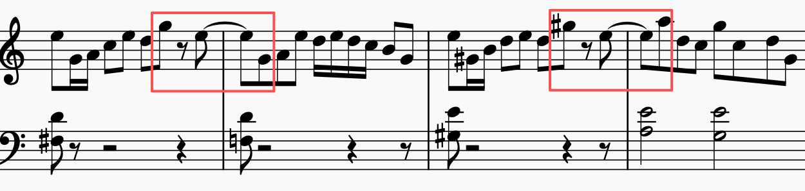

YOASOBI的「アイドル」：

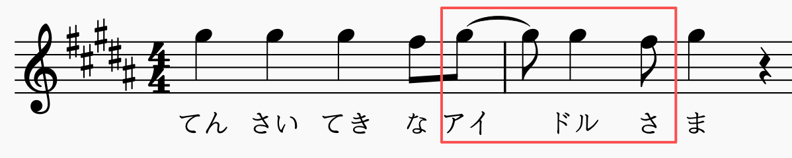

## 在旋律中交错使用节奏型

「残酷な天使のテーゼ」的副歌段，节奏型是`4-4 3-3-2 4-4 3-5`，在以“2拍子”为基础的节奏与“3拍子”为基础的节奏之间来回切换：

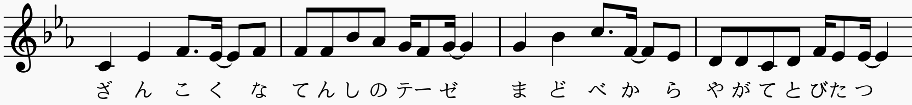

「勇者」的bridge段使用`2-3-3` + `3-3-2`

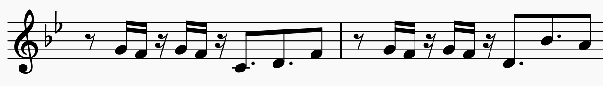

米津玄師「砂の惑星」的副歌段，节奏型反复在`o234`和`3-3-2`之间切换：

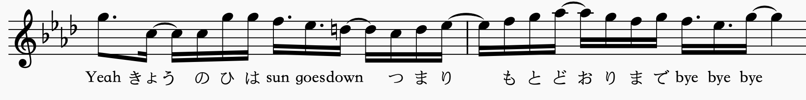

## 复节奏

多个声部之间，每个声部使用不同的节奏型，称为“复节奏(polyrithm)”。

最简单的例子是3对2：右手以2拍为单位，左手以3拍为单位

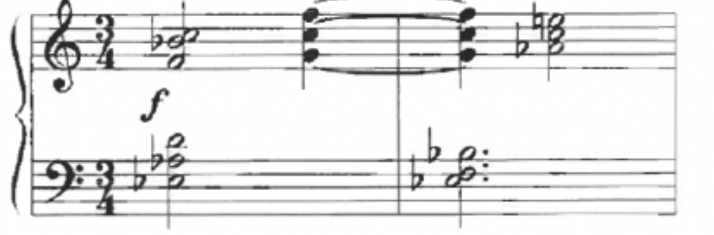

下面这个例子有三个声部，上方两个声部以3拍为单位，下方声部以2为单位

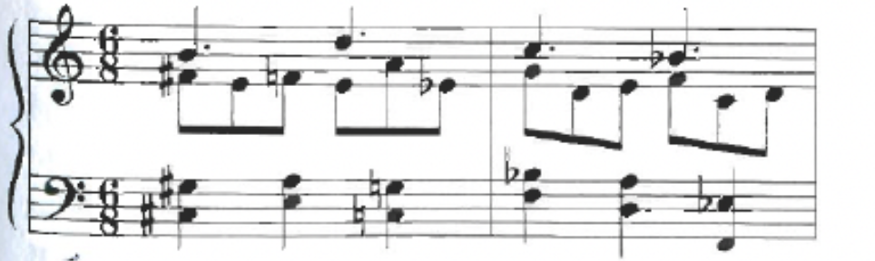

下面这个例子在每小节局部使用复节奏：第一小节右手是`3-3-2`，左手是`2-3-3`；第二小节是两手之间3对2

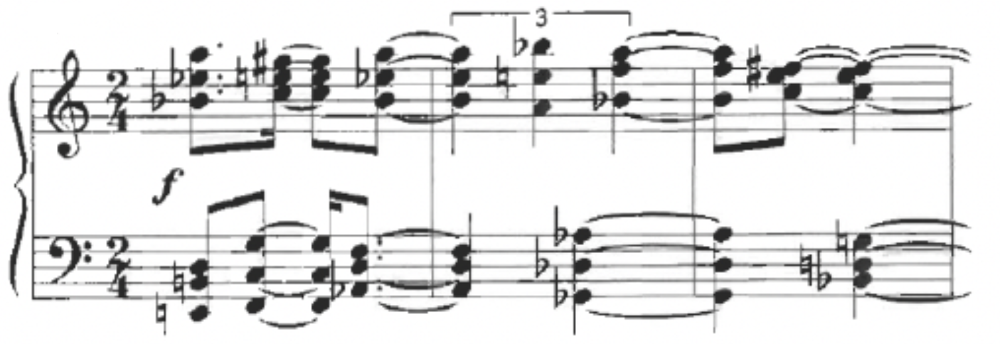

也可以不同声部用不同的小节线：

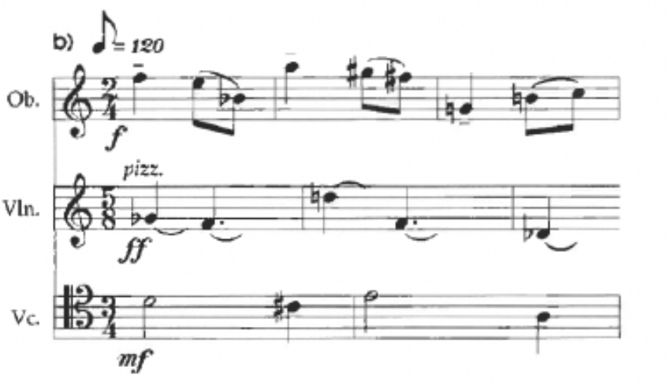

## 等节奏

等节奏(isorhythm)指某一个声部内部有两个循环，一个是节奏的循环（称为talea），一个色彩的循环（称为color）。Talea和color的周期可以相同，也可以不相同。

梅西安「时间终结四重奏」的第一乐章，钢琴声部由一个29个和弦的循环构成color，一个17个和弦的节奏型构成talea。17和29互质，在乐章的有限篇幅内永远不会重新对齐，营造出“没有终点”的时间感：（我用红色和蓝色标出了不同的color，用黄线分割talea）

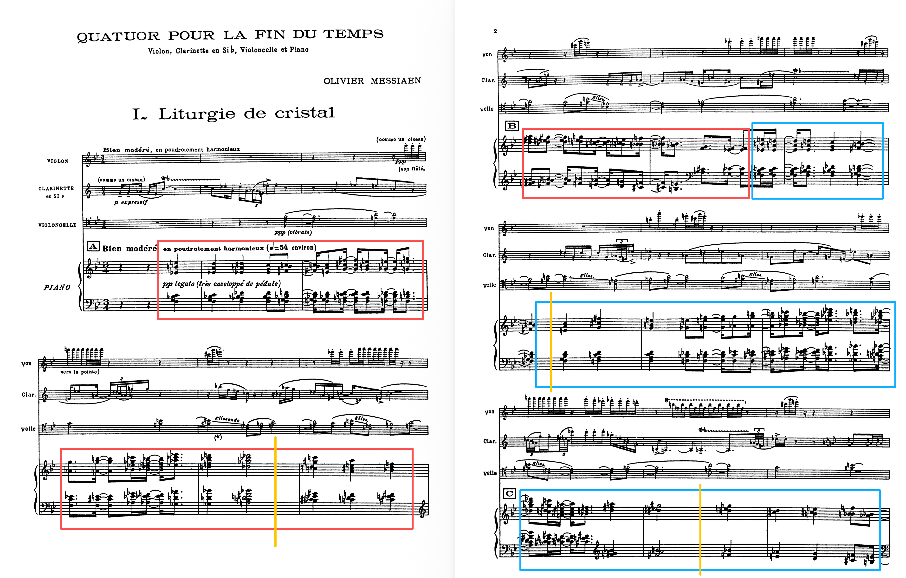

## 不规则重音

斯特拉文斯基的「春之祭」第一幕“春之预兆”，通过标注重音记号摆脱了小节线的限制，在二拍子的框架下创造了不规则的节奏型。

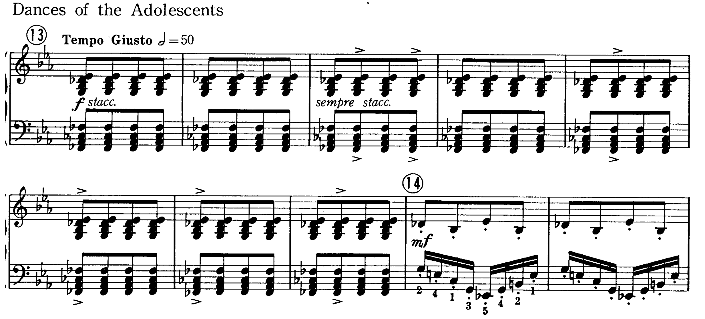

> 乍一看重音分布没有规律可循，但如果以重音为界，数出每个重音紧随其后的音符个数，就会得到：9, 2, 6, 3, 4, 5, 3。可以看到，这个数列有一个单调递减的子序列9 6 4 3和一个单调递增的子序列2 3 5交错组成。其中，6 4 3的差分恰好是-2-1，2 3 5是+1+2，具有某种对称性。当然，斯特拉文斯基是否是这样计算出来的我们就永远不得而知了。然而，“由两种不同截然不同的节奏‘秩序’相互干扰产生表面上的混乱”是一种典型的斯特拉文斯基理念。

而在「春之祭」的最后一幕“献祭之舞”中，斯特拉文斯基使用了“每小节变换拍号”的方式来表示不规则节奏：

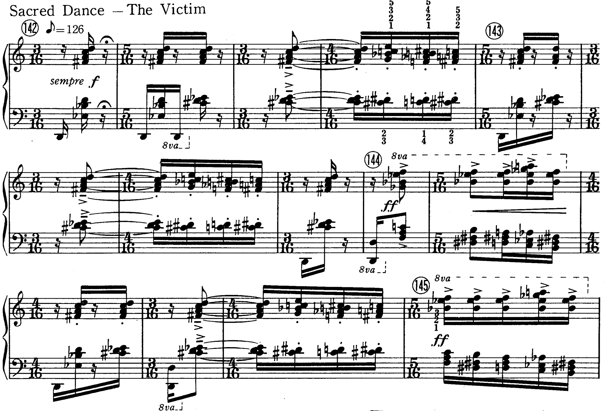

## 有限的偶然

传统节奏要求演奏家严格按照曲谱规定的节奏进行。而卢托斯瓦夫斯基(Lutoslawski)引入了“有限的偶然(limited aleatorism)”的概念，允许演奏家用带有即兴的节奏变化反复演奏某一乐段，直到指挥给出下一个手势进入下一乐段。

以Chain II为例，我们看到总谱上标出了弦乐各个声部反复演奏某一音型，横线代表音型的延续。直到指挥给出手势进入下一阶段前，每个人都按照自己的呼吸和手感反复拉奏自己的小片段。这会产生一种完全不同于古典音响的“复杂的错位感”，这种“集体即兴”称为“微观节奏组织(microrhythmic organization)”。当许多没有对齐的音响同时出现时，统计学规律就会自动生成一种人类大脑无法精确计算的类似大自然的“宏大复杂性”。这种“非作曲家人为”的分配节奏的方式，也把演奏家从许多先锋派作曲家要求的极其复杂的不规则节奏中解放了出来。

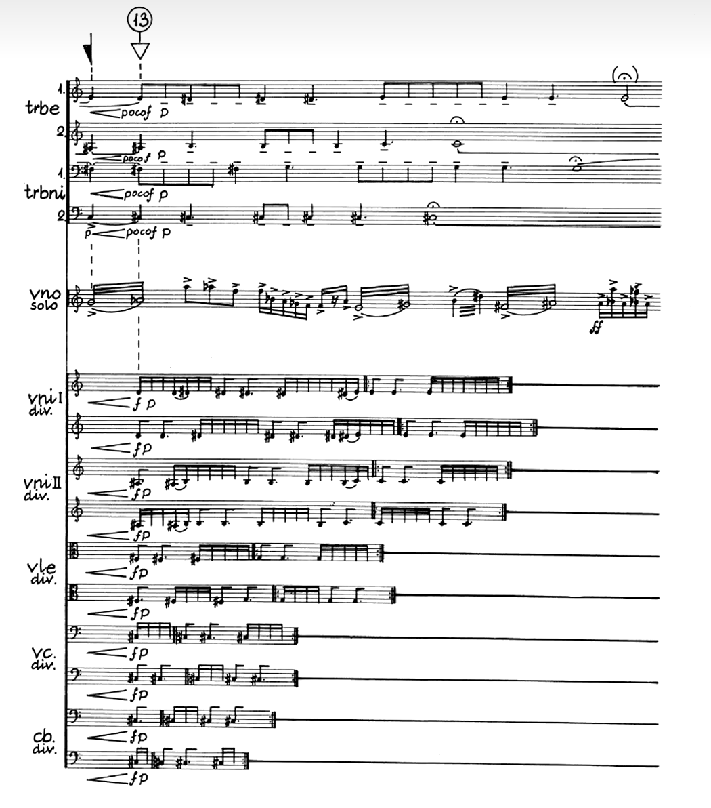

这里，“有限的偶然”是相对于“绝对的偶然”而言的。例如，约翰·凯奇的《4分33秒》就是“绝对的偶然”的音乐：由于总谱上缺乏任何对演奏的指示，声音是完全不受控制的。然而，卢托标记出演奏家“大致要做什么”，而具体的细节由演奏家自行决定，这是一种“受控的偶然”。一般而言，卢托不会让演奏家自行决定音高，而通常是自行决定节奏。

> 随着录音设备的普及，古典音乐循规蹈矩的演奏方式的确会逐渐被电子设备取代。如古尔德所说，为什么我们需要这么多训练得完美的人肉播放器呢？于是，20世纪诞生了两条路。一条路上的人们接纳了电子设备的确定性（例如，以“初音未来”为代表的用Vocaloid软件制作的电子音乐）。另一条路上的人们就如卢托所做的那样，用偶然性解放了演奏家的自由。这样，曾经被古尔德批评的舞台表演形式就再度具有了意义。无论哪条路，都是要把人类从“机器化”中解放出来。某种程度上，这是一种人道主义宣言。卢托说：“音乐不仅是一连串声音现象，它也是由一群人类（演奏家）所进行的一项活动。这些演奏者中的每一个人所具备的丰富潜能，远超一份纯粹抽象的乐谱所能要求的。我想要将人类个体心灵所展现出的那种丰富性纳入到作曲手段的宝库之中。”

## 参考资料

[1] Fang Man - 上海交通大学2026春，音乐风格与作曲技法
[2] Wikipedia - Stravinsky
[3] 鸢梦Yumeko - 争议不断？热度还是太高了！史上最全杂谈芙莉莲OP1，带你走进YOASOBI的世界
[4] 鸢梦Yumeko - 老冰旧神！从四套三开始聊「God knows...」——希望、力量、与漫无止境的青春