[^Date]: 2026.11.11
[^Title]: 调性和声
[^Tag]: Music, Composition
[^Order]: 1

## 基础概念

### 音高

用`0`~`11`这12个数字来指代钢琴上的音高(pitch)：

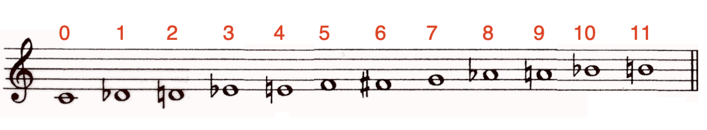

>  在十二平均律的调律下，后一个音的振动频率是前一个音的$2^{1/12}$倍。

### 音高类

如果忽略八度的差别，钢琴上的音高就被分为了12个“音高类(pitch class, pc)”。

在分析音乐时，我们会关注音乐使用的音高的集合。把选取的音乐片段所涉及的音高去重后从低到高排列，取所有排列法里最低音和最高音之间音程最小的那个（如果存在两种最低音和最高音音程同样小的排列法，就选择第一个音和第二个音之间音程尽量小的排列法；如果还有重复，取第二个和第三个之间音程尽量小的；...），得到的音高列构成“音高类集合(pitch class set, pc set)”。在讨论pc set时，我们不关心绝对音高，只关心相对音高，所以第一个数字统一写为0。例如，在下面这首巴托克的作品中，我们观察到前五个小节钢琴右手的旋律只用到了`A`,`B`,`C`,`D`这四个音，那么把它整理成pc set就是`[0,2,3,5]`。

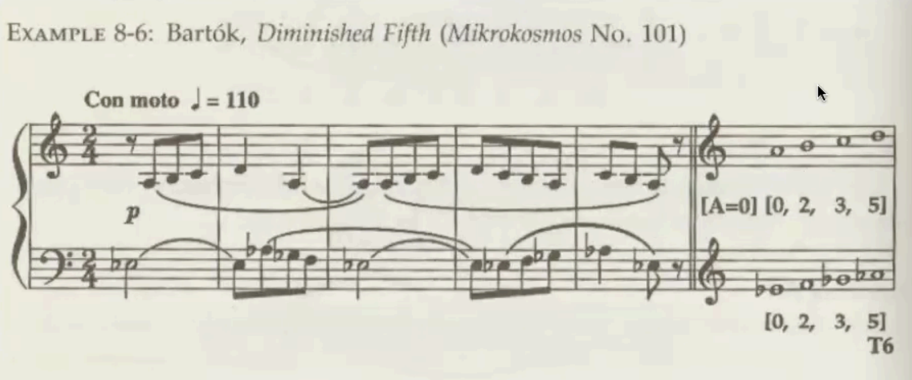

### 自然音阶

钢琴上的七个白键对应音高序列`0,2,4,5,7,9,11`，这称为“自然大调音阶(natural major scale)”。我们习惯用字母表示自然大调音阶上的七个音，它们分别对应`C,D,E,F,G,A,B`。而`A,B,C,D,E,F,G`（也即`9,11,0,2,4,5,7`）称为“自然小调音阶(natural minor scale)”。

`C,D,E,F,G,A,B`以C开头，称为“C自然大调音阶”。保持两两之间间隔不变，平移到以G开头，就称为“G自然大调音阶”。小调同理。

### 音程

我们用“音程(interval)”来表示两个音之间的距离。在数字音高的表示法中，音程也用数字表示。例如，`2`和`5`的音程为3。因此，音程也对应数字0~11。而在分析音乐时，我们经常会忽略音程的转位关系：例如我们认为“`0`和`4`的音程”与“`4`和“`12`”的音程”是等价的（“`12`”的频率是`0`的2倍）。于是用0～11表示的音程可以缩减为0～6。这称为“音程类(interval class, ic)”。

调性音乐习惯用“度”来表示音程，它表示两个音在自然音阶上的距离。这个七音音阶上相邻的两个音称为“二度”，间隔一个音的两个音称为“三度”，以此类推。“`12`”和`0`的音程称为“八度”。然而，“度”对音程的刻画是不精准的，例如自然大调音阶上，同样是三度，第一个音和第三个音之间的音程是4，第三个音和第五个音之间的音程是3。因此，要配合“大”、“小”、“增”、“减”来确定具体音程。每个音与自己构成“同度”，数字音程1称为“小二度”，2称为“大二度”，3称为“小三度”，4称为“大三度”，5称为“纯四度”，6称为“增四度”或“减五度”，7称为“纯五度”，8称为“小六度”，9称为“大六度”，10称为“小七度”，11称为“大七度”。

> Lutoslawski使用interval class的概念时，有时会区分纯四度和纯五度（因为音响不同）。这时候他会用interval class “7” 表示纯五度。

对于一个$n$个音的pc set，音高之间两两形成$\dbinom{n}{2}$个音程。每个音程用interval class（一个1到6的数字）表示，统计每个interval class出现的次数，就形成了一个6维向量，这个向量称为“音程向量(interval vector)”。例如，pc set `[0,2,3,5]`两两音程分别为2, 3, 5, 1, 3, 2，因此interval vector为`(1,2,2,0,1,0)`。Interval vector可以用来判断pc set的协和程度。如果它的第一维和第六维比较少，那么意味着小二度和增四度出现得少，听感也就更协和。

### 大和弦、小和弦、属和弦

多个音同时演奏形成“和弦(chord)”。在调性和声里，和弦主要通过三度叠置来构造。以C自然大调音阶为例：取自然大调音阶的第一、三、五、七、九（二）、十一（四）、十三（六）向上堆叠，构成“大和弦(major chord)”；降低三音和七音，构成“小和弦(minor chord)”；不降低三音，只降低七音，构成“属和弦(dominant chord)”。

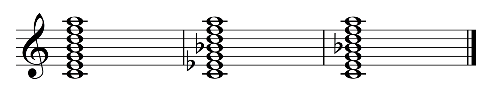

C称为和弦的根音。上述和弦一直堆叠到了十三音。只堆叠前三个，称为“三和弦(triad)”；只堆叠前四个，称为“七和弦(seventh chord)”；只堆叠前五个，称为“九和弦(ninth chord)”；只堆叠前六个，称为“十一和弦(eleventh chord)”；堆叠七个，称为“十三和弦(thirteenth chord)”。再往上堆叠就回到了根音C。

大和弦的三和弦、七和弦、九和弦、十一和弦、十三和弦采用的和弦标记如下，分别称为“大三和弦(major triad)”、“大七和弦(major seventh)”、“大九和弦(major ninth)”、“大十一和弦(major eleventh)”、“大十三和弦(major thirteenth)”：

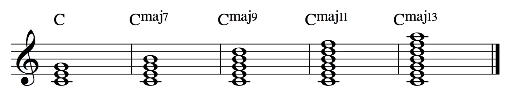

小和弦的三和弦、七和弦、九和弦、十一和弦、十三和弦采用的和弦标记如下，分别称为“小三和弦(minor triad)”、“小七和弦(minor seventh)”、“小九和弦(minor ninth)”、“小十一和弦(minor eleventh)”、“小十三和弦(minor thirteenth)”：

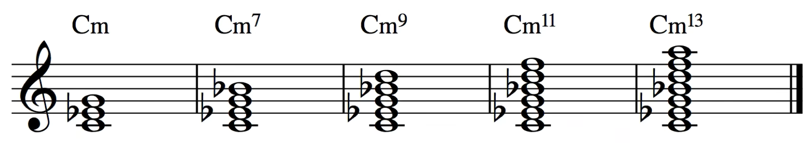

属和弦的七和弦、九和弦、十一和弦、十三和弦采用的和弦标记如下，分别称为“属七和弦(dominant seventh)”、“属九和弦(dominant ninth)”、“属十一和弦(dominant eleventh)”、“属十一和弦(dominant thirteenth)”：

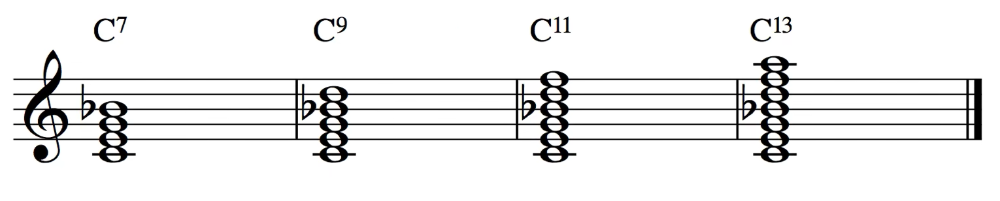

在和弦上添加额外的音高时，在原本的和弦标记基础上使用`add`记号。例如：

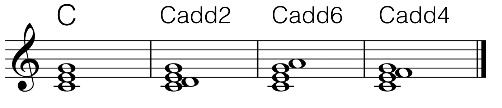

把和弦中的“三音”替换成其它和弦音，使用`sus`记号（suspend，指把三音“悬吊”起来）。如果只写`sus`不写数字，默认把三音悬挂为四级音。例如：

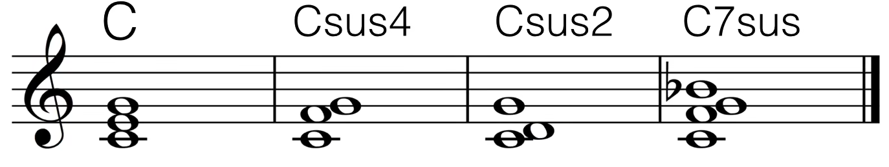

省略和弦音，使用`omit`记号。例如：

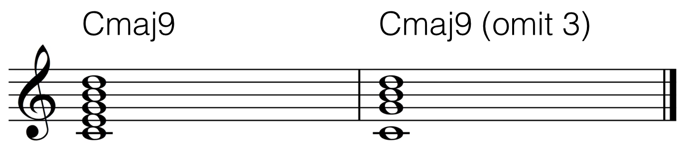

和弦音如果要做升降变化，直接在括号里写出。例如：

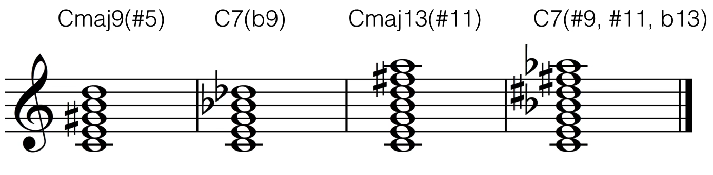

### 增和弦与减和弦

只用大三度做堆叠，得到的和弦称为“增和弦(augmented chord)”。大三度堆叠到第四个音就会回到根音，因此增和弦只有一种，也即“增三和弦(augmented triad)”。

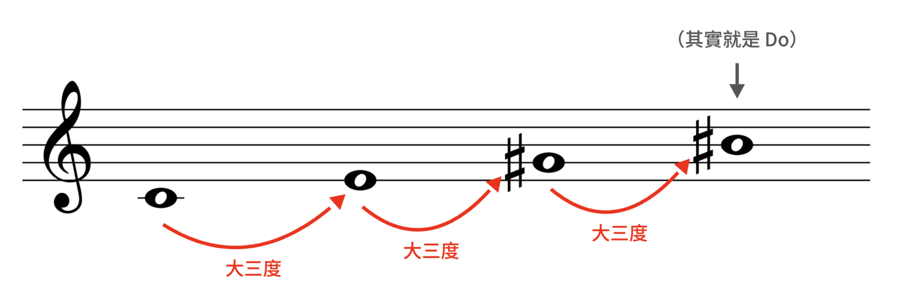

只用小三度做堆叠，得到的和弦称为“减和弦(diminished chord)”。小三度堆叠到第五个音就会回到根音，因此减和弦只分为“减三和弦(diminished triad)”和“减七和弦(diminished seventh)”：

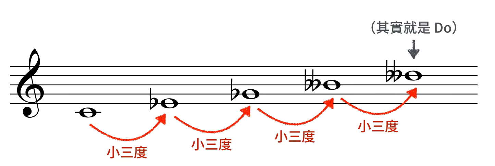

以根音为C为例，分别记为`Cdim`与`Cdim7`：

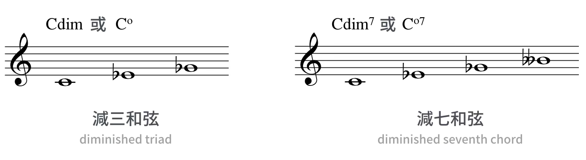

减三和弦的interval vector是`(0,0,2,0,0,1)`，减七和弦的interval vector是`(0,0,4,0,0,2)`。可见，它总是含有增四度，同时不包含纯四度、大三度，所以减和弦会产生紧张、不协和的听感。

### 半减七和弦

小七和弦降低五音得到“半减七和弦(half-deminished seventh chord)”。根音为C的半减七和弦记为`Cø`：

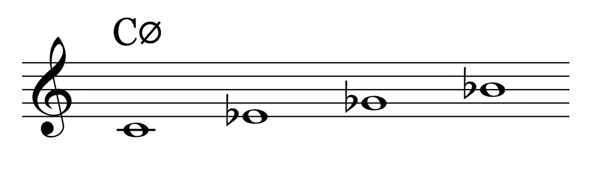

半减七和弦恰好是自然大调音阶七级音开始的三度堆叠，也是自然小调音阶二级音开始的三度堆叠：

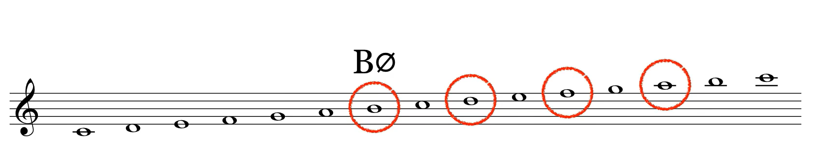

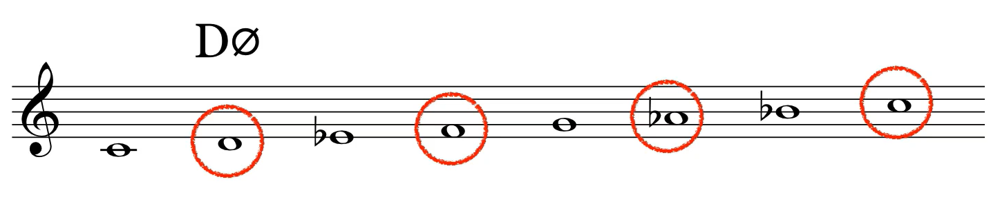

### 和弦的转位

对于$n$个音的和弦，把和弦最低的$k$个音升高一个或多个八度从而改变和弦的根音，得到的和弦称为原和弦的“第$k$转位($k$-th inversion)”。转位的和弦用斜杠标出转位后的最低音。如果斜杠后写的音名不在和弦内，直接加到和弦下方。例如：

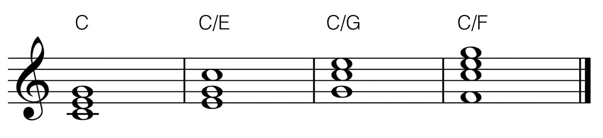

## 调性与功能

一个音阶本身并不指定一个音高中心，它只是一个pc set。例如，C自然大调音阶`C,D,E,F,G,A,B`（`0,2,4,5,7,9,11`）并不一定以C为中心。

> 我们将会看到：以C为中心是C大调；以A为中心是A小调；以D为中心是多利亚调式；以F为中心是多利亚调式；等等。

为音乐确定一个唯一的音高中心，也就确定了“调性(tonality)”。调性确立之后，不同音高不再互相平等，而将处于不同的地位层级。

### 调性的建立

计算自然大调音阶的interval vector，得到`(2,5,4,3,6,1)`。可以观察到，六个interval class出现的次数各不相同：出现次数最多的是纯四度（纯五度），它出现了6次；出现次数最少的是增四度，它只出现了1次；其次少的是小二度，它出现2次。

给定一个音程为纯五度的音高对时，包含这对音高的自然大调音阶有6个。例如，给定C和G，会发现C, E$\flat$, F, G, A$\flat$, B$\flat$这六个自然大调音阶都包含这对音高。然而，给定一个音程为增四度的音高对时，包含这对音高的自然大调只有2个。例如，给定B和F，只有C和F$\sharp$自然大调音阶包含这对音高。给定一个音程为小二度的音高对时，包含这对音高的自然大调也只有2个。例如，给定E和F，只有C和F自然大调音阶包含这对音高。

这说明，出现次数越少的音程，携带的“区分自然大调音阶”越多。例如，如果在使用自然大调的音乐里反复出现B和F，那么人的听觉能够自发确定当前自然音阶始于C或F$\sharp$；如果进一步听到E，那么已经可以确定当前音阶就是C自然大调音阶，因为F$\sharp$自然大调音阶中不包含E。反之，如果听到的是纯五度，那么可能的音阶有6个。简言之，在音阶的interval vector里出现次数越少的音程，携带的“调性信息”越多。

一旦识别出唯一的自然音阶，不同音高之间的不同地位就会自发显现。从历史悠久的旋律与和声写作实践，到现代的听觉实验，都像我们展示出人类具有某些普遍性的听觉偏好。在自然大调音阶上，七级音倾向于进行到一级音，四级音倾向于进行到三级音，这两对半音进行是自然大调音阶上倾向性最强的；六级音倾向于进行到五级音，二级音倾向于进行到三级音或一级音；三级音和五级音倾向于进行到一级音；...由此可见，自然大调音阶的七个音中，一级音是绝对的中心，称为“主音(tonic)”。三级音和五级音次之，分别称为“中音(mediant)”和“属音(dominant)”。这三个音构成自然大调音阶主音上的大三和弦，是最稳定的三个音。剩余的四个音倾向于进行到这三个稳定的音，其中二级音称为“上主音(supertonic)”，四级音称为“下属音(subdominant)”，六级音称为“下中音(submediant)”，七级音称为“导音(leading tone)”。确定了主音，也就确定了调性。

### 增四度的解决

自然大调音阶中唯一的一个增四度由下属音和导音构成，它们不仅是音阶上最不稳定、最具有倾向性的两个音，同时还形成增四度极不协和的听感。因此，人类听觉习惯于尽快消除这种感觉，这称为“解决(resolution)”。调性音乐很大程度上就是建立在这种从“不协和”到“解决”之间形成的张力之上的。以B和F为例，我们已经计算得知它们只可能属于C大调或F$\sharp$大调。若紧随其后出现的是C和E，那么可以唯一确定调性为C，并且这符合B向C进行、F像E进行的自然倾向。而如果紧随其后出现的是A$\sharp$和F$\sharp$，那么可以唯一确定调性为F$\sharp$。在以上两个例子中，前者通过增四度向内进行半音解决，后者通过增四度向外进行半音解决，分别确立了不同的调性。可见，增四度的解决方向就是在两个候选调之间做出选择。这里的“紧张-解决”的听感，同时也是“两种可能的调”的歧义的消除。

C大调自然音阶里，在属音上向上堆叠三度得到的七和弦`G-B-D-F`是属七和弦，恰好同时包含了C大调里唯一的三全音B,F和导音B。这个属七和弦解决到主和弦时，有三种推动力叠加在一起：三全音B,F向内解决到C,E，消除了调的歧义；导音B上行半音到主音C；根音G下行纯五度（或上行纯四度）到C。因此，属七和弦到主和弦的进行对音乐具有强劲的推动力，同时也是确立调性最强的手段。省略属七和弦的七音，属音上的三和弦进行到主和弦也具有强推动力，也是确立调性的强手段，只是相比于属七和弦稍弱。

> 五级到一级的进行是最常见的和声进行，常在音乐材料告一段落时用作终止。关于终止式的内容，将会在[曲式](TODO超链接到曲式一文)一文中具体介绍。

### 大调的功能体系

综上可见，增四度的解决和相距五度的和弦进行是建立调性和推动音乐发展的重要手段，甚至可以称为是所有调性音乐运行的基本逻辑。一般而言，调性音乐会被安排为“从主和弦出发，最终回到主和弦”的运动。于是，一个和弦在此运动过程中所处的位置就具有重要意义。我们将建立一个称为“功能(function)”的模型来衡量和弦在“离开主和弦，最终回到主和弦”这一过程中“距离主和弦的距离”。

以C自然大调音阶为例。称主音上的大三和弦`C`具有“主功能(tonic function)”，它通常被描述为具有“稳定”、“在家”的听感，一般也作为乐曲的开始和结束。称属音上的大三和弦`G`或属七和弦`G7`具有“属功能(dominant function)”，它具有强烈的向主功能解决的倾向，通常被描述为“想回家”的听感。称下属音上的大三和弦`F`具有“下属功能(subdominant function)”，它可以由主和弦下行五度得到，通常被描述为“刚出家门”的听感。

根据“在家”、“刚离开家”、“想回家”的功能直观，可以用`C`, `F`, `G`这三个大三和弦讲一个最简单的故事`C-F-G-C`：主角从家出发，又回到家。这形成了一个最基本的和声进行模式，称为“主-下属-属-主”，简写为T-S-D-T或1451。

这一功能直观还意味着，属功能连接下属功能是违背常理的，人不会“想回家”然后“刚离开家”。一般而言，调性音乐严格禁止属和弦进行到下属和弦。

我们已经为`C`,`F`,`G`这三个和弦赋予了功能。接下来我们考虑自然大调音阶上的所有顺阶和弦，也即剩下的四个和弦：`Dm`, `Em`, `Am`, `Bdim`：

> “顺阶和弦(diatonic chords)”就是指在音阶上向上做三度堆叠得到的和弦。其中，一、四、五级是大和弦，二、四、六级是小和弦，七级是减和弦。一般依次用罗马数字表示：I, ii, iii, IV, V, vi, vii(dim)。

我们采用Hugo Riemann的做法，把这些和弦的功能也归入“主”、“属”、“下属”这三个功能中的一个（甚至多个）。可以用作分类的基本依据的是和弦之间的共同音，因为共同音意味着共同的“解决倾向”：`Dm`和`F`有两个共同音F,A，且`Dm7`本身包含了`F`的全部三个音，因此把`Dm`归入下属功能；`G7`去掉根音就是`Bdim`，因此`Bdim`归入属功能；`Em`和`C`和`G`都有两个共同音，它属于主功能还是属功能需要视上下文而定。

> 尽管不同和弦可以拥有同一种功能，但同一种功能的和弦之间可以进一步区分“强弱”。例如，`G7`作为属功能通常比`G`更强；`Em`位于主功能和属功能的边界上，对应这两个功能都较弱；等等。

于是，C大调的顺阶三和弦可以按照T-S-D-T的进行法则形成下表所示的连接法，按照这个连接法写作和声进行通常会得到听感连贯、有始有终的音乐：

| 主              | 下属     | 属   | 主       |
| --------------- | -------- | ---- | -------- |
| `C`            | `F`        | `G`/`G7` | `C`        |
| `C`$\to$`Em`        | `Dm`       | `Bdim` | `Em`$\to$`C` |
| `C`$\to$`Am`        | `F`$\to$`Dm` | `Bdim`$\to$`G`/`G7` | `Am`$\to$`C` |
| `C`$\to$`Em`$\to$`Am` | `Dm`$\to$`F` |  `G`/`G7`$\to$`Bdim`   |          |
| `C`$\to$`Am`$\to$`Em` |          |      |          |

### 小调的功能体系

自然小调音阶`A,B,C,D,E,F,G,A`里，顺阶和弦的大/小性质恰好与大调音阶相反。一、四、五级是小和弦，三、六、七级是大和弦，二级是减和弦，用罗马数字记为：i, ii(dim), III, iv, v, VI, VII。

然而，自然小调音阶的第七级音与主音相距全音，五级和弦是小三和弦/小七和弦因此没有增四度的解决倾向。由此可见，自然小调的属和弦-主和弦进行建立调性的能力很弱。为此，人们经常把自然小调的第七级音升高半音，得到`A,B,C,D,E,F,G#,A`，这称为“和声小调音阶(harmonic minor scale)”。此时，导音再次拥有了像主音进行的倾向，五级和弦变成了大三和弦`E`，属七和弦`E7`包含导音G$\sharp$和增四度D,G$\sharp$。和声小调音阶的顺阶和弦性质变成了：一、四级是小和弦，五、六级是大和弦，二级、七级是减和弦，三级是增和弦，用罗马数字记为：i, ii(dim), III(aug), iv, V, VI, vii(dim)。

和声小调顺阶和弦的功能和自然大调同理。以A小调为例，`Am`是主功能，`Dm`是下属功能，`E`/`E7`是属功能。其余和弦根据共同音归入这三类功能。

## 调外和弦

我们已经讨论了顺阶和弦的功能。而一般来说，一个音乐片段不会全都使用顺阶和弦，而会经常引入调外的和弦来使音乐变得丰富。

### 临时主功能

#### 副属和弦

在衔接到一个和弦时，可以在这个和弦前方插入根音上方五度音上的属七和弦，这个属七和弦就称为这个和弦的“副属和弦(secondary dominant chord)”。例如下图中，`C`进行到`Em`时，用E上方的五度音B上的属七和弦`B7`做衔接（这里省略了五音）：

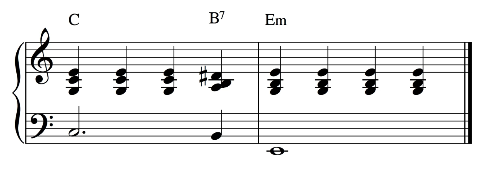

可以看到，副属和弦引入了调外音D$\sharp$，因此属于调外和弦。这个调外和弦之所以在听感上不突兀，正是利用了属七和弦向主和弦的强烈的解决倾向。当副属和弦出现时，听觉强烈要求其走向调内的那个下方五度的和弦。这个下方的和弦在此处充当“临时的主功能”。

金承志「彩虹」，`A7`-`Dm7`（V7/ii）

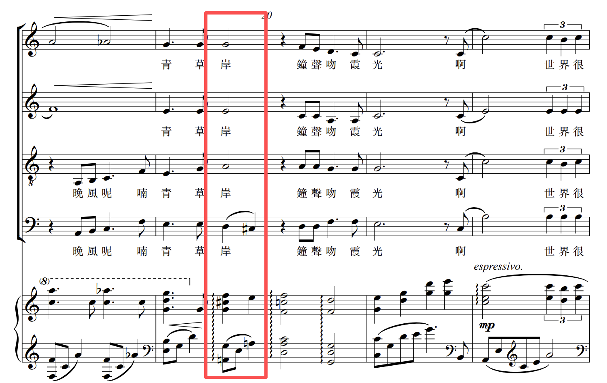

潘行紫旻「云中来信」，`D`-`Gm7`（V7/ii）：

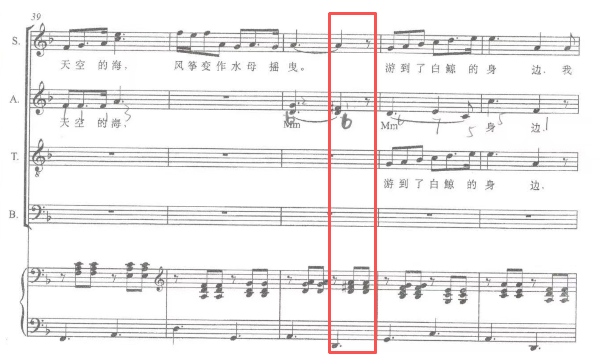

海顿的「惊愕交响曲」，`D-G`（V7/V）：

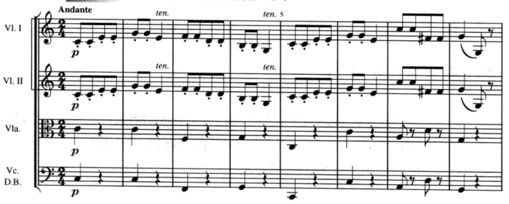

副属和弦可以连续使用。例如，椎名林檎的「修罗场」bridge段结尾：

【TODO】

肖邦的「圆舞曲No.7」中红框片段的和声进行是`G#7-C#7-F#7-B7-E7`，而这恰好构造出一个上方呈半音阶下行的进行：

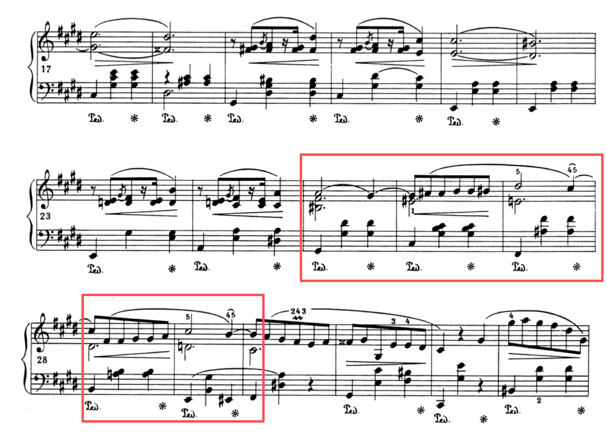

#### 副导和弦

和副属和弦类似，把一个和弦看作临时的主功能，在它前面插入对应的导音上的和弦，这个和弦就称为“副导和弦(secondary leading-tone chord)”。副导和弦的功能和原理和副属和弦是完全类似的。事实上，副属和弦省略根音就是副导和弦。

【例子TODO】

#### 副下属和弦

同理，把一个和弦看作临时的主功能，在它前面插入对应的下属音上的和弦，这个和弦就称为“副下属和弦(secondary subdominant chord)”。

【例子TODO】

### 属功能的替代

属和弦向主和弦解决的倾向主要来自于属和弦三音和七音之间不协和的增四度（增四度又称为“三全音(tritone)”）。可以把属和弦的功能看作主要是由这个三全音产生的。那么，我们可以选择另一个含有同一增四度的和弦来替换原本的和弦，这样就完成了属功能的替代。

#### 三全音代理

把一个副属和弦换成另一个含有同一增四度的属和弦，这就是属和弦的“三全音代理(tritone substitution)”。例如，在下例中，`F`前如果使用副属和弦应该是`C7`，它含有E和B$\flat$构成的三全音。现在我们找到另一个属七和弦`F#7`，它也含有这对三全音，因此可以做三全音代理：

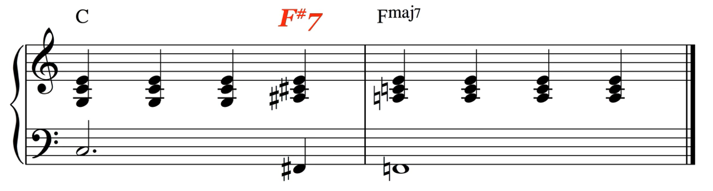

注意到，用作三全音代理的那个属七和弦恰好是终点和弦上方半音上的属和弦。于是，三全音代理的规律就可以总结为：可以使用上方半音的属和弦来做衔接。

另一种特别的做法是用大和弦（例如大13和弦）来代替三全音代理的属七和弦。例如上例中把`F#7`替换为`F#13(#11)`。

【图片TODO】

#### 减和弦与半减七和弦

减三和弦可以看作省略了根音的属七和弦；半减七和弦可以看作省略了根音的属九和弦；减七和弦可以看作省略了根音的降低了九音的属九和弦。它们都含有属和弦的那对三全音，因此也可以被用来替换属功能的和弦。

### 下属功能的加强

#### 那不勒斯和弦

那不勒斯和弦(Neapolitan chord)是指一个音阶的第二级音降半音上的大三和弦。它在功能上可以看作下属和弦。无论是大调音阶还是小调音阶，它总是会包含这个音阶的下属音。在古典音乐里，小调音阶的那不勒斯和弦经常以第一转位的形式被使用。例如贝多芬的「月光奏鸣曲」第一乐章里使用了那不勒斯和弦第一转位：

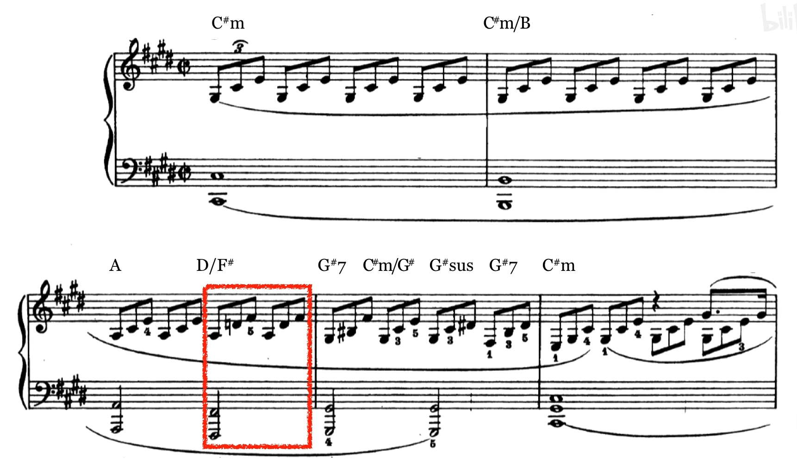

可以看到，小调音阶的那不勒斯和弦第一转位根音恰好和下属和弦相同，但却是一个大三和弦，这就在黯淡凄凉的小调环境中产生了一种“明亮的悲叹”的色彩。18世纪意大利那不勒斯的歌剧中，作曲家经常用这个和弦来表达主角极度的绝望、震惊、悲痛或是面临死亡的瞬间。

#### 增六和弦

当我们要接到属和弦时，如果想要增加解决的急迫感，用一种方法是同时把高音和低音都各自向下向上缩减半音，这样形成了一个增六度音程，所以我们把这样的和弦称为“增六和弦(augmented sixth chord)”。

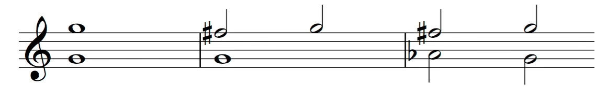

> 属七和弦的最外部音程也是增六度，所以在和弦记号里一般会把增六和弦记为属七和弦的变化和弦

以C大调为例，人们总结出了三种解决到G的增六和弦使用方法。以C大调为例：

第一，增加C音，从而自然过渡到G中的B。（意大利增六和弦，形式最简单，常出现在意大利早期歌剧里）

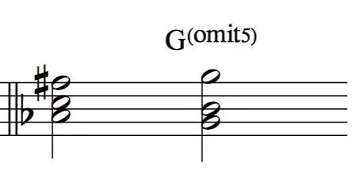

第二，增加C和D，从而自然过渡到G中的B和D。（法国增六和弦，色彩丰富，带有不协和摩擦音响）

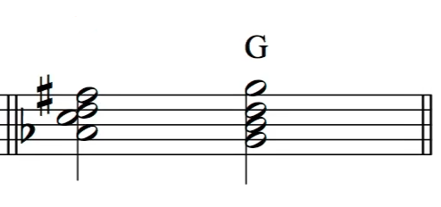

第二三，增加C和$\flat$E，从而自然过渡到G中的B和D，同时也能自然过渡到C/G中的C和E。（德国增六和弦，厚重、宏大、充满极强推力，符合德奥浪漫主义风格）

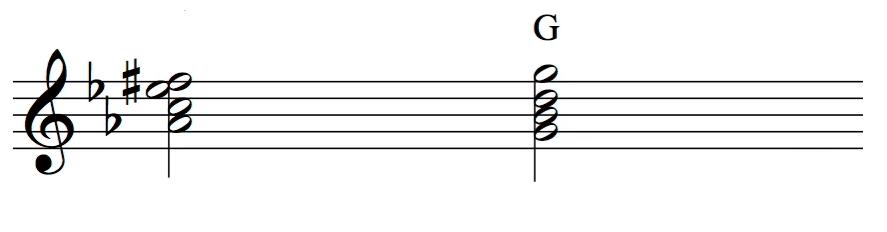

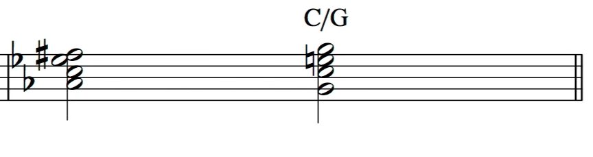

### 借用和弦

#### 皮卡迪三度

在常理应该接小三和弦地方使用大三和弦，这样的用法称为皮卡迪三度(Picardy Third)。在巴洛克时期，皮卡迪三度是一种被广泛使用的小调乐曲的终止形式。例如，在巴赫平均律中我们经常看到这样的终止：

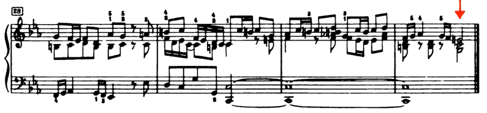

#### 调式交替

在作曲时，也可以经常尝试调式的互换。例如在C大调顺阶和弦只有七个，正常的C大调曲子可以只用这三个和弦。但是在作曲时，可以临时使用七个C小调的顺阶和弦在相同的位置进行替换，创造出更丰富的听感。

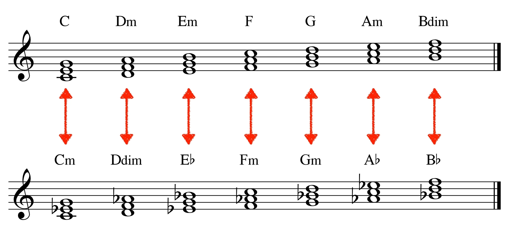

「珠玉」频繁使用了调式交替。可以看到旋律反复时`Dm`替换为了`D`。

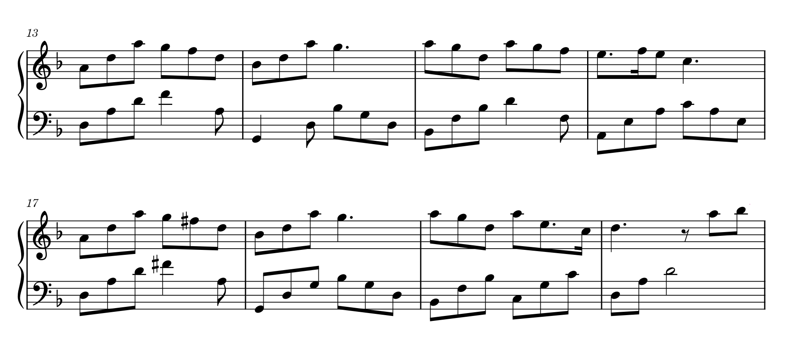

## 和弦进行

### 五度圈进行

自然大调音阶顺阶和弦根音五度下行也符合[大调功能体系](#大调的功能体系)一节中的表格的连贯性，由此得到“五度圈”进行：`C-F-Bdim-Em-Am-Dm-G-C`。

莫扎特「第25号交响曲」第一乐章第37小节起，弦乐高声部奏出从主和弦`B♭`开始的下行五度圈进行：`B♭-E♭-Adim-Dm-Gm-Cm`。

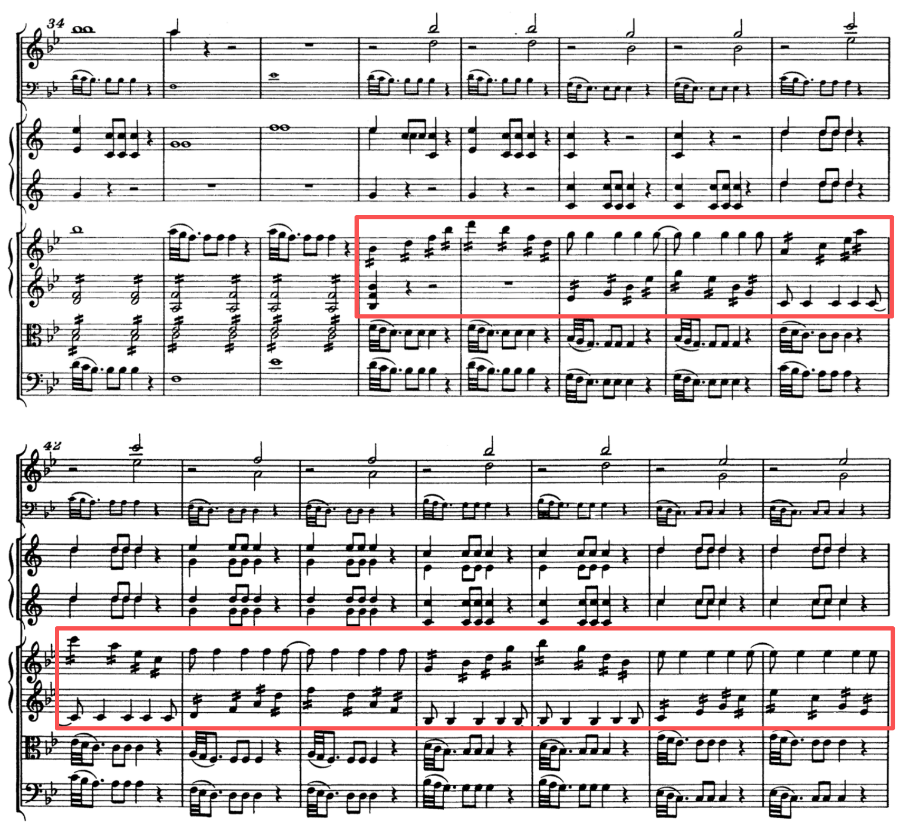

#### 2-5-1 

从二级和弦出发沿五度圈向下走三步，得到“2-5-1”的和弦进行。从功能上，它恰好是下属-属-主，因此常用来加强正格终止：

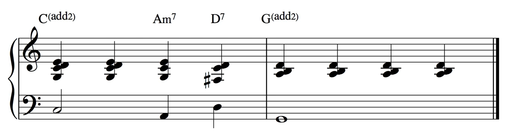

小调时2-5-1依然取顺阶和弦，此时“2”是减和弦（如果是七和弦，则和声小调对应减七和弦，自然小调对应半减七和弦）：

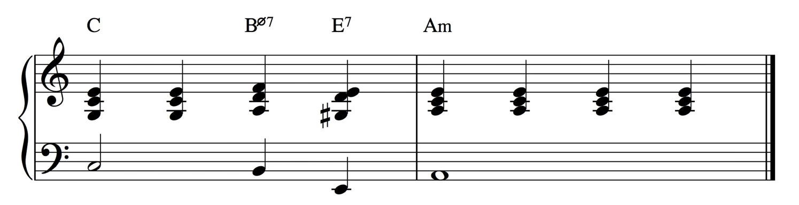

#### 6-2-5-1

从六级和弦出发沿五度圈向下走四步，得到“6-2-5-1”的和弦进行。因为一级接六级也是主功能内部的和弦替换，因此“6-2-5-1”可以连贯地循环。

五度下落有强劲的推动力。其中，六级和二级循环是小和弦，带有忧伤的色彩。五级和一级是大和弦，带有明亮的色彩。“6-2-5-1”的循环形成忧郁、明亮的情绪交替，因此被大量抒情歌曲广泛使用。

肖邦的「圆舞曲」：

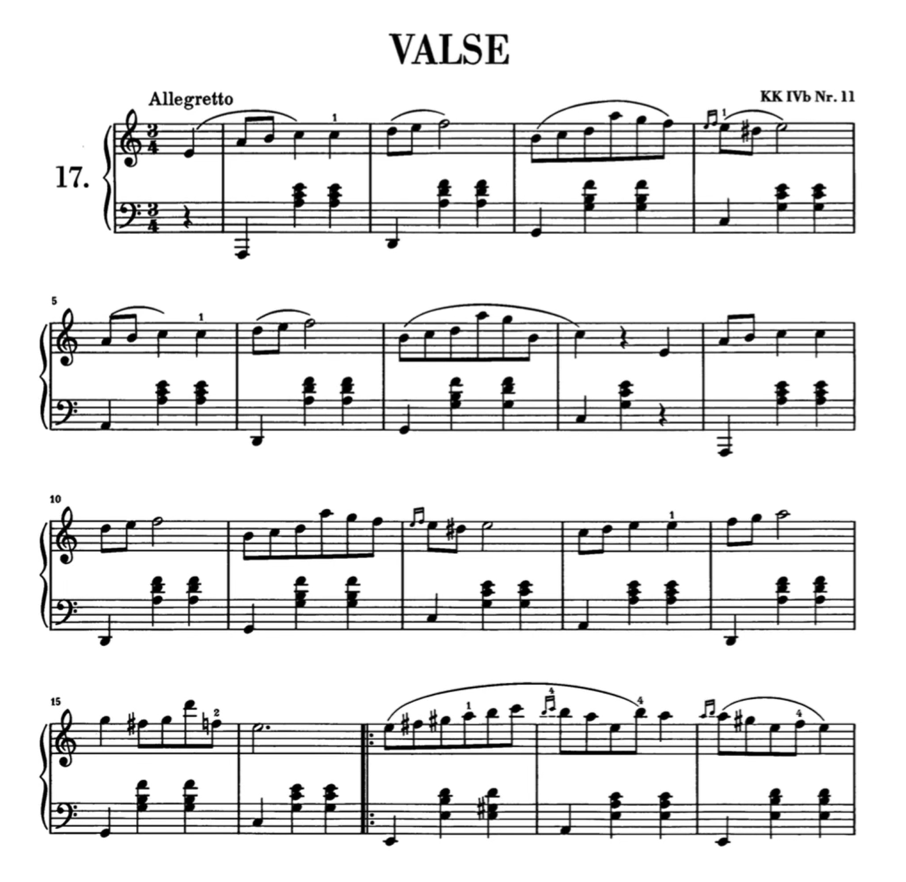

循环也不必须从“6”开始。由此形成“1-6-2-5”的变体。「凉面、素面、有时乌冬面」（也就是「曼波、曼波、有时哈基米」的原曲）使用了七和弦和`add6`修饰的“1-6-2-5”：（`Dmaj7-Bm7-Em-Aadd6`）

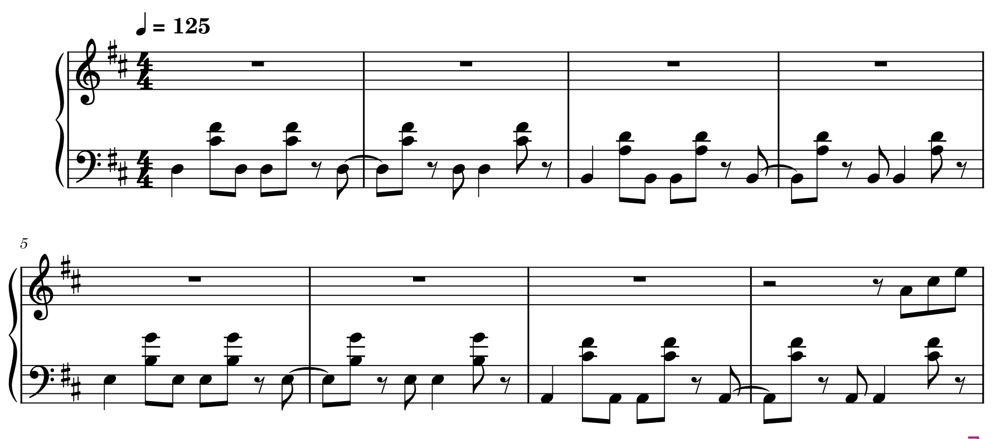

用同样是下属和弦的“4”代替“2”，得到“6-2-5-1”的常见的变体“6-4-5-1”、“1-6-4-5”等。

洛天依「一封孤岛的信」（著小生zoki创作）使用“6-4-5-1”：（在“1”进行到“6”时，根音插入了导音使衔接更连贯）

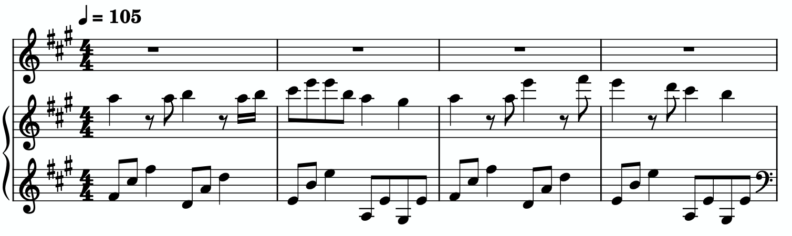

灌篮高手主题曲「君が好きだと叫びたい」副歌的开头使用“1-6-4-5”：

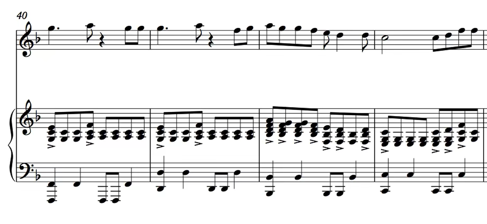

在五度圈进行中，可以用副属和弦代替原本的顺阶和弦来增增加和声进行的推动力：

【例子TODO】

### 三度进行

从[大调功能体系](#大调的功能体系)一节中的表格出发就可以看到，自然大调音阶顺阶和弦根音三度下行形成的“三度圈”是一个连贯的和声进行：`C-Am-F-Dm-Bdim-G-Em-C`。三度圈上任意两个和弦都有两个共同音。

【例子TODO】

### 八度法则进行

【需要从曲式复制过来】

### 根音半音阶下行

一个根音是半音阶下行的进行：

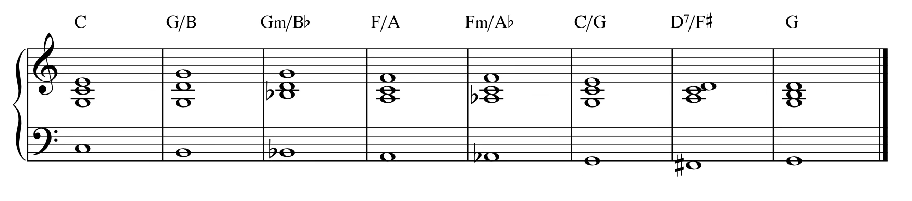

其中第三个和弦Gm/B$\flat$可以替换为大三和弦、减三和弦或减七和弦；第五个和弦Fm/A$\flat$可以替换为半减七和弦或减七和弦；C/G是终止六四和弦；D7/F$\sharp$是副属和弦，可以替换为半减七和弦或减七和弦；最后的G是半终止，使得整个和声进行可以循环。

把上面的两个C和弦换成Cm和弦，就得到了一个小调版本：

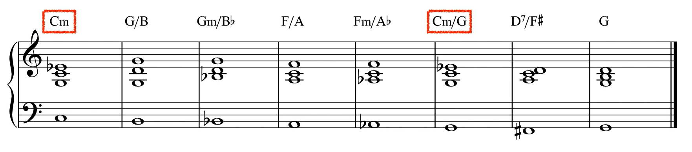

### 卡农进行

【TODO】

### 王道进行

#### 4-5-3-6

顺阶和弦“4-5-3-6”的进行称为王道进行，听感非常抓耳。它还有一个加强版4-5-3-6-2-5-1，在流行音乐中被使用到了几乎泛滥的程度。1-4-5-3-6也是其一个变体，可以看作明朗版的王道进行。

C大调音阶的王道进行是F-G-Em-Am，它在下属和弦与属和弦后接到了属于主功能的小和弦Em和Am，整个过程推进感极强，同时明亮中带有一丝忧郁（日本称之为mellow感）。

Never Gonna Give You Up：（第一个和弦$\flat$G增加了低音$\flat$E，也就是$\flat$Em7）

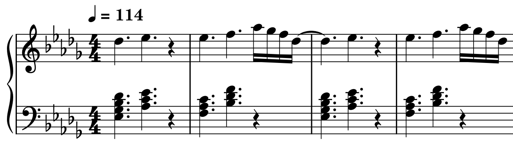

千千阙歌：（E大调，A-B-G$\sharp$7-C$\sharp$m是4-5-3-6，其中G$\sharp$7不是简单的顺阶和弦而是C$\sharp$m的副属和弦，这是王道进行的一个常见变体）

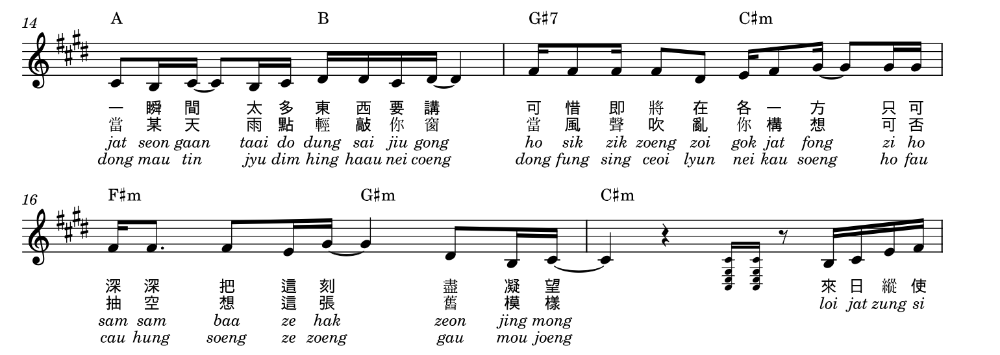

《あしたはトゥモロー》的pre-chorus使用4-5-3-6，在6上使用了属七（九）和弦：

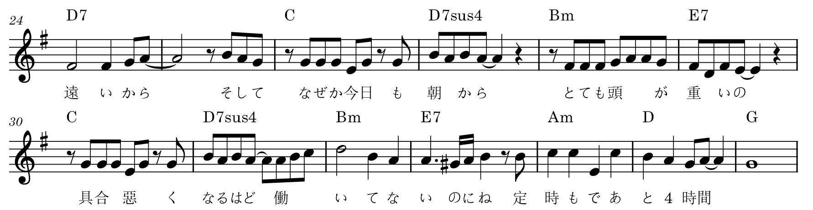

注意，王道进行中的4-5-3-6的数字并不是指首调的音高。例如，A小调的王道进行依然是F-G-Em-Am，而不是Dm-Em-C-F。在A小调使用王道进行时，首调音高实际上是6-7-5-1，最后的1一般会直接作为终止。

#### 4-5-3-6-2-5-1

王道进行加强版

#### 2-5-3-6

由于二级和弦同样是下属功能，所以2-5-3-6是王道进行的一个常见变体。

#### 4-5-6

在上世纪末的欧陆舞曲中很常用的和弦进行4-5-6可以看作王道进行的变体。4-5-6可以称为欧陆进行，也在流行音乐中大量使用。例如《拼凑的断音》：

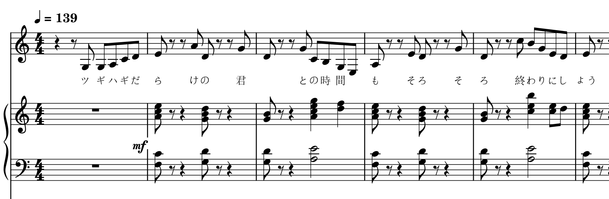

#### 4-3-6-5-1

“IV-iii-vi-v-I”因为日语歌曲《丸ノ内サディスティック》而得名。在C大调下为F-Em-Am-Gm-C。F制造离家感，Em,Am营造出徘徊不知所归的氛围，最特别的是解决到I之前使用了小和弦来作为五级和弦，有一种特别的凄凉感。

YOASOBI的アイドル：$\flat$D大调，$\flat$G-Fm7-Bm7-($\flat$Am?)-D

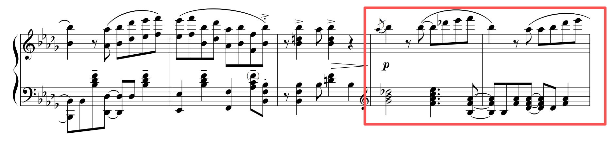

### 半音平移进行

【这个能不能归入第三节】

在和弦连接时，直接插入后一和弦整体平移半音（往高或往低）的和弦，也是一种常用的手法。例如：

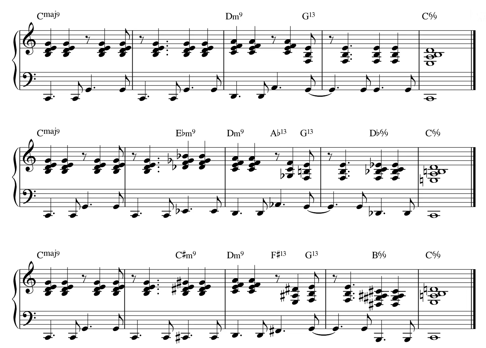

### 12小节蓝调

C调下，12小节蓝调用的基本和弦是C7,F7,G7。如下：（注意到，著名的blues note，也就是C调下的$\sharp$F并没有出现在这组和弦音里，blues note其实是针对蓝调旋律而言的。12小节蓝调是蓝调的地盘，而blues note是蓝调旋律的灵魂）

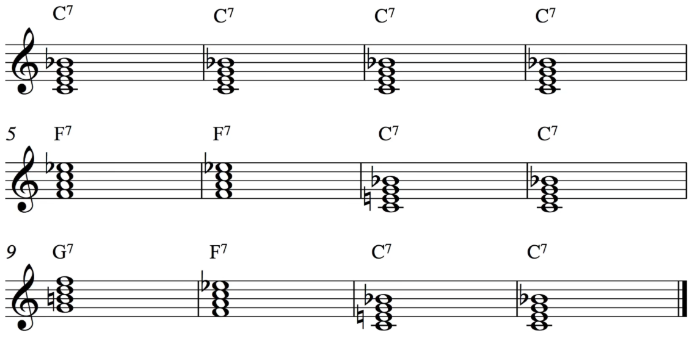 

## 参考资料

[1] 官大为 - 好和弦
[2] Fang Man
[3] Aninaas - 【极简日本音乐史】6. J-POP最常用的“王道和弦进行4536”探源：J-POP的舞曲源头（含456进行）
